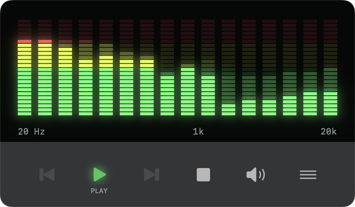

# LC Music Player（LCMP）

LC Music Player（LCMP）は、落ち着いた音楽鑑賞体験を目指すmacOSのネイティブ音楽プレイヤーです。前世紀（Last Century：LC）の楽曲プレイヤーのように情報を控えめに表示し、グラフィックイコライザーなどの可視化で再生を楽しめるようにします。

<!-- The screenshot is a 2x (Retina) capture of the 360x210pt main window; width keeps it at actual size. -->


## 主な機能

- **ローカル音源の再生**：ファイルやフォルダを登録して再生します。音楽ファイル自体はアプリへコピーしません。対応形式はMP3、M4A（AAC・ALAC）、WAV、AIFF、FLACです。読み込みと再生はmacOSの機能（Core Audio）で行い、第三者のライブラリは使いません。
- **複数のプレイリスト**：リストの作成・改名・削除と、M3U8の読み込み・書き出しができます。曲はドラッグで並べ替えられます。ライブラリ・リスト・現在の対象は保存され、次の起動時は自動再生せずに復元します。
- **ランダム再生**：リストの全曲を重複なしの順序で1巡します。オン・オフは次の起動でも使います。
- **音源の管理**：登録した音源をフォルダごとにまとめて表示し、フォルダ単位でライブラリから除外できます。元のファイルは削除しません。
- **可視化**：拡張画面の表示タブで、次の2つのデザインを切り替えます。
  - 「Last Century イコライザー」：再生中の周波数レベルを、16列の蛍光管LEDで−80〜0dBFSの範囲に表示します。ミュート中も音源のレベルに反応します。
  - 「MICRIGAIKE コジョーズ」：山上の秘湯のステージで、5匹のオコジョが音域ごとに、曲の拍に合わせて歌い踊ります。
- **曲ごとの音量をそろえる**：全曲のLUFSとtrue peakを測定して、曲ごとに固定のゲインを適用します（既定OFF）。手動音量・ミュートは独立して使えます。
- **背景での事前測定**：プレイリストへの追加時と起動時に、各曲の音量を背景で順次測定し、結果をキャッシュします。事前測定だけでは再生音量を変えません。

仕様と設計の詳細は[文書一覧](docs/README.md)を参照してください。

## ビルドして起動する

macOS 14以降、Swift 6.2以降に対応するXcode／Command Line Tools、Python 3.9以降を使用します。

```sh
make release
open build/release/LCMP.app
```

- 起動中のアプリと同じ出力先を置き換えないでください。終了してから再ビルドするか、`make release RELEASE_OUTPUT=build/preview/LCMP.app`のように別の出力先を指定します。
- 開発用は`make debug`、ローカル検証用のZIPは`make archive`、配布用に作り直したアプリを入れたインストーラー（DMG）は`make dmg`です。
- パッケージの依存はなく、ビルドにネットワーク接続は要りません。
- アプリのバージョンは`<メジャー>.<マイナー>.<ビルド番号>`の形で、ビルド時にGitの履歴から決まります。決め方は[バージョン](docs/build-and-deploy.md#バージョン)を参照してください。

前提環境、出力先の変更、配置・更新、署名と配布の範囲は[ビルド・配置手順](docs/build-and-deploy.md)を参照してください。

## 使い方

| 操作 | 方法 |
| --- | --- |
| 音源を登録する | メニュー→音源タブからファイル／フォルダを登録します。ファイルはCommand＋Oでも登録できます |
| リストに曲を追加する | リストの「曲を追加」から登録します |
| 再生する | 停止・一時停止中は、曲行をダブルクリックするか、単クリックで選んでからメインの再生ボタンを押します。「このリストを再生」で先頭から始めることもできます |
| 曲を切り替える | 再生中は、別の曲行を単クリックすると切り替わります |
| 曲を並べ替える | 曲行をドラッグします。Escで取り消せます。右端の上下ボタンでも移動できます |
| ランダム再生 | 「現在の再生リスト」の行の、曲数の左にある交差した矢印のボタンで切り替えます |
| 一時停止・再開 | Spaceキー |
| シーク | 表示領域をクリックするとシークバーが出ます。ドラッグで位置を移動します |
| 音量 | 音量ボタンで縦型の音量を開きます。小音量を細かく調整できます。フォーカスが外れるか15秒間操作がないと閉じます |
| リストを管理する | 管理からリストの作成・改名・削除と、M3U8の読み込み・書き出しを行います |
| フォルダを除外する | 音源タブで、フォルダの見出しのゴミ箱ボタンを押します。確認の後、そのフォルダの全曲をライブラリと各リストから除外します |
| 可視化を切り替える | 拡張画面の表示タブで、デザインのカードを選びます |
| バージョンを確認する | 設定の「このアプリについて」、またはアプリメニューの「LCMPについて」で表示します |
| 拡張画面を開く | メニューボタンで下部に拡張画面を開きます |

停止後は先頭から再生し、シークで再生位置を準備できます。

## テスト

```sh
make test
LCMP_TEST_AUDIO_OUTPUT=1 ./scripts/swift.sh test --no-parallel
```

- 1つ目は通常のテストで、音声を出力しません。scriptsのPythonのテスト（ライセンス索引・バージョン・アイコン・DMG）も実行し、テストが`~/Library/Preferences`に設定ファイルを残していないことも確かめます。
- 2つ目は、既定の出力先へ小さいテスト音を送る実再生のテストです。`--no-parallel`を外して並列に実行しても成功します。
- 詳しくは[ビルド・配置手順のテスト](docs/build-and-deploy.md#テスト)を参照してください。
- ファイル選択画面、聴感、デバイスの切替の手動確認の方法は[基本再生機能の実装設計](docs/design/02_playback-implementation.md)を参照してください。

## ディレクトリとファイル

| パス | 内容 |
| --- | --- |
| `Sources/` | アプリ、画面、再生・ライブラリ・前処理・解析・音声処理のモジュール |
| `Tests/` | 各モジュールの検証と独自のテスト音源 |
| `assets/` | アプリのアイコンとインストーラーの背景（scriptsで図形から描いた生成物） |
| `scripts/` | Swiftの実行、アプリの作成・署名、バージョンの決定、インストーラーの作成、アイコンと背景の描画、テスト音源の生成と、それらのテスト |
| `docs/` | ビルド・配置手順と設計書（[文書一覧](docs/README.md)）、READMEの画像 |
| `Makefile` | ビルド、ZIPの作成、インストーラー、通常のテストの入口 |
| `Package.swift` | SwiftPMの定義（パッケージの依存はありません） |
| `AGENTS.md`／`CLAUDE.md` | コーディングエージェント向けの作業指示 |

## 開発の運用

このリポジトリではGitflowを基にブランチを運用します。リモートリポジトリ（`origin`）はGitHubのリポジトリで、`main`・`develop`とバージョンタグを置きます。

| ブランチ | 用途 |
| --- | --- |
| `main` | リリースした履歴とバージョンタグを管理します。直接コミットせず、`develop`へのfast-forwardだけで進めます |
| `develop` | 日常の開発内容を統合します |
| `feature/<短い名前>` | `develop`から作成し、作業の完了後に`develop`へマージコミットを作って統合します（`--no-ff`） |
| `release/<バージョン>` | リリースの準備時に`develop`から作成します。検証と修正の後に`develop`へ統合し、`main`へ反映します |
| `hotfix/<短い名前>` | リリース済みのバージョンへの緊急の修正用です。`develop`から作成し、`develop`へ統合してから`main`へ反映します |

`main`への反映は、次の手順で行います。

1. `main`で`git merge --ff-only develop`を実行し、`main`を`develop`と同じコミットへ進めます。`main`にマージコミットは作りません。
2. そのコミットに、注釈付きタグ`v<バージョン>`（例：`v0.20.49`）を付けます。タグの名前は、そのコミットから`scripts/app_version.py`で求めたバージョンと一致させます。

- `main`にマージコミットを作らない理由：バージョンのマイナーは、ビルドしたコミットから第1親をたどったマージの数で決まります。`main`にマージコミットを作ると、そのコミットのバージョンが`develop`と食い違います。
- fast-forwardできないとき（`main`に`develop`にないコミットがあるとき）は、統合せずに開発者へ相談します。`hotfix/`を急いで出したいのに、`develop`にまだリリースしない変更があるときも同じです。
- `main`への統合、タグ付け、pushは、開発者の指示があるときだけ行います。pushするときは、`main`・`develop`とタグを`origin`へ送ります。

設計書には合意した仕様と実装済みの設計を記載します。作業の進め方と記録の扱いは[AGENTS.md](AGENTS.md)に定めています。

## ライセンス

LCMPのオリジナル成果物（ソースコード、テスト、スクリプト、文書、画像）は、Apache License, Version 2.0（Apache-2.0）の下で提供します。[LICENSE](LICENSE)と[NOTICE](NOTICE)を参照してください。

アプリは第三者のライブラリを含みません。第三者のコード・素材・引用等を加える場合は、それぞれに付された著作権表示とライセンスが適用されます（[依存ライブラリと同梱構成](docs/design/11_third-party-dependencies.md)）。

ビルドしたアプリには、本体のLICENSEとNOTICEを`Contents/Resources/LCMPLicense`へ同梱し、設定の「ライセンス…」で表示します。
