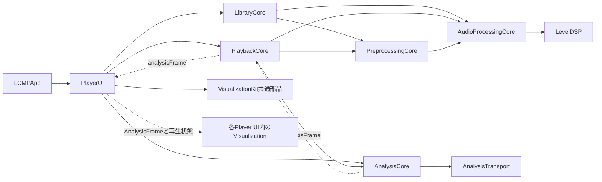

# Player UI・可視化の開発ガイド

[設計書一覧](../README.md)に戻る。

## 1. 概要

Player UIは再生操作と画面構成を扱い、可視化は解析結果から表示を作る。現在の実装名・組込IDは`LCMP_default_GEQ`で、コンパクトな操作画面と、拡張画面で切り替える3つの可視化デザイン（16列の蛍光管LED、オコジョ合唱団、教育番組）を組み合わせる。本書は、ソースの配置、他のモジュールとのI/F、可視化の開発・追加の手順をまとめる。

製品の仕様は[基本設計](00_basic-design.md)と[UI・UX設計](01_ui-ux-design.md)、具体的な画面の動作は[コンパクト画面](09_compact-ui-implementation.md)、提示待ち・残光・描画の詳細は[可視化の実装設計](08_visualization-implementation.md)に記載する。

## 2. ソースの配置

```text
Sources/
├── LCMPApp/
│   └── LCMPApp.swift                  アプリ・ウィンドウ・ファイル選択
├── PlayerUI/
│   ├── PlayerView.swift               アプリ向けのメイン画面の入口
│   ├── AppVersion.swift               正式名称とInfo.plistからのバージョン表示
│   ├── TransportStateMapping.swift    再生の状態からウィジェットの状態への対応
│   ├── AlwaysOnDisplay.swift          iPhoneの常時表示（自動ロックを止める判定と電池の監視）
│   ├── Acknowledgements/
│   │   └── Acknowledgements.swift     ライセンスの表示モデル・View
│   └── Players/
│       ├── LCMP_default_GEQ/          このPlayer UIの実装一式
│       │   ├── LCMPDefaultGEQ.swift   ID・名前・解析設定・表示データへの変換
│       │   ├── LCMPDefaultGEQPlayerView.swift  メイン画面と操作部
│       │   ├── PlayerPresentation.swift       画面の状態とdriverの所有
│       │   ├── ExtensionView.swift            拡張画面
│       │   ├── WindowLayout.swift             ウィンドウの配置の計算
│       │   ├── PlayerFrame.swift              画面の枠（macOSのウィンドウ・iPhoneのカード・全画面・パネル）と文字の大きさ
│       │   ├── NativeControls.swift           移動・シーク・音量の入力（macOS）
│       │   ├── TouchControls.swift            同じ名前の入力部品のiOS版（タッチ）
│       │   ├── VolumeControls.swift           音量の操作曲線・内部のフォーカス境界
│       │   ├── PlaylistClickSurface.swift     マウスのクリック回数・行のドラッグ
│       │   ├── LibraryControls.swift          リストの操作・グラス・ランダム再生・睡眠タイマー・常時表示の切替等
│       │   ├── SourceFolderList.swift         音源のフォルダ一覧
│       │   ├── QuickTooltip.swift             省略されたタイトルの表示
│       │   └── Visualization/
│       │       ├── VisualizationDesign.swift      デザインの種類・表示名・共通の解析設定・driverの契約
│       │       ├── VisualizationThumbnail.swift   表示タブのカードのサムネイル
│       │       ├── PlaybackVisualization.swift    再生・解析と描画の接続、デザインの切り替え
│       │       ├── LCMPDefaultGEQView.swift       蛍光管LEDのSwiftUI/Canvasとrenderer
│       │       ├── LCMPDefaultGEQScale.swift      dBFSから表示感度への変換
│       │       ├── SpectrumPresentation.swift     提示待ち・16×24セル・残光
│       │       └── VisualizationDriver.swift      蛍光管LEDのMainActorの受信・時計
│       ├── Micrigaike_Kojoes/         MICRIGAIKE コジョーズ（オコジョ合唱団）の一式：原画・キャラクタ・演出・指揮役・描画・サムネイル・driver・View
│       └── Kyouiku_Bangumi/           教育番組（パペット）の一式：キャラクタ・演出・指揮役・背景・組み立て・Metalの描画・driver・View
│           └── Art/                   同梱の絵（パッケージのリソース）：背景の絵、パペットの部品と数値
├── VisualizationKit/
│   └── Shared/
│       ├── SpectrumSample.swift       UIに依存しない表示用レベル・時刻の値型
│       └── VisualizationClock.swift   共通のhost clock・activity
├── ControlSurfaces/                   iPhoneのホーム画面のウィジェットの記号・配置・共有の状態（依存なし）
├── PreprocessingCore/                 先頭PCMの準備・LUFS/ピークの測定・共通のデコーダと形式変換
├── AudioProcessingCore/               測定値・設定・補正計画・独立したgain段
├── LevelDSP/                          worker用のK-weighting/true peak補間（C）
├── PlaybackCore/                      再生制御・音声バックエンド
├── LibraryCore/                       ライブラリ・リスト・ファイル参照
├── AnalysisCore/                      FFT・帯域パワー・解析の時刻
├── AnalysisTransport/                 音声側の固定容量のPCM受け渡し
└── CSQLite/                           システムSQLiteへのリンク

Tests/PlayerUITests/
├── Acknowledgements/
│   └── AcknowledgementsTests.swift
├── AlwaysOnDisplayTests.swift
└── Players/
    ├── LCMP_default_GEQ/
    │   ├── NativeViewTests.swift
    │   ├── PlayerInteractionTests.swift
    │   ├── PreprocessingSettingsTests.swift
    │   ├── WindowLayoutTests.swift
    │   ├── FolderTooltipTests.swift
    │   ├── VisualizationIntegrationTests.swift
    │   └── Visualization/
    │       ├── PresentationTests.swift
    │       └── VisualizationPerformanceTests.swift
    ├── Micrigaike_Kojoes/
    │   └── ErmineChorusTests.swift
    └── Kyouiku_Bangumi/
        ├── PuppetShowTests.swift
        ├── PuppetShowRenderingTests.swift
        └── PuppetShowPerformanceTests.swift
```

配置の規約は次のとおりとする。

- **1つのPlayer UIの実装は、可視化も含めて`PlayerUI/Players/<実装ID>/`の1つのフォルダ配下へまとめる。** 内部の整理には`Visualization/`等のサブフォルダを使う。解析設定、表示感度、driver、残光、描画、画面の状態、入力、配置もこの実装の一部である。
- 独自の世界観を持つ可視化デザイン（MICRIGAIKE コジョーズ、教育番組等）は、そのデザインを構成するファイル一式を`PlayerUI/Players/<デザインID>/`へまとめる。デザインの種類・切り替え・サムネイルの枠・再生との接続など、複数のデザインで使う部品は、組み込む先のPlayer UIの`Visualization/`に置いたままでよい。
- `VisualizationKit/Shared/`にはUIに依存しない共通部品だけを置く。個別のPlayer UIの描画を登録したり、個別のView・スケール・driverを参照したりしない。Player UIから共通部品を利用する一方向の依存にする。
- 音声エンジン・FFT・ライブラリの保存は、それぞれのCoreモジュールへ委ねる。
- フォルダはSwiftのモジュールや名前空間ではない。Player UIごとのソースは、現在の`PlayerUI`ターゲット内でコンパイルされる。新しい型には実装固有の接頭辞を付け、別の実装で同名の`PlayerPresentation`等を重複して定義しない。
- AppKitを使う部品は`#if os(macOS)`で囲み、同じ型名と引数のiOS版を`TouchControls.swift`に置く。共用のViewはOSを意識せずに部品を使う。メイン画面の大きさは`playerFrame`の環境値で決まり、macOSのウィンドウ（360×210pt）の寸法を変えない。
- 通常のSwiftファイルはサブフォルダにあってもSwiftPMが検出するため、移動や追加だけなら`Package.swift`の変更は不要である。ターゲットや画像等のresourcesを追加する場合は、別途manifestを変更する。
- 画像等の素材は、デザインのフォルダ内の`Art/`等にまとめ、`PlayerUI`ターゲットのresourcesに`.copy`で加える。素材はリソースのバンドル（`LCMP_PlayerUI.bundle`）に入る。macOSのアプリでは`scripts/build-app.py`がContents/Resourcesへ入れ（アプリの直下に置くと署名が壊れる）、iPhoneのアプリではXcodeが直下へ入れる。読み込みは`Bundle.module`ではなく、両方の場所とテストの実行場所を探す`PuppetShowArt.directory`の方法に合わせる。新しいターゲットにresourcesを持たせる場合は、`build-app.py`の`RESOURCE_BUNDLES`にも加える。

## 3. モジュール間のI/F



実線は利用・依存、破線はデータの流れを示す。`PlayerUI`が`AnalysisCore`の解析結果を受け取り、専用フォルダ内の可視化へ渡す。`VisualizationKit`は共通の値型と時計だけを提供し、他のアプリ固有のモジュールへ依存しない。

| 境界 | 公開I/F | 呼出側の担当 |
| --- | --- | --- |
| アプリ → メイン画面 | `PlayerView(playback:presentation:library:chooseFile:toggleExtension:)` | 再生・ライブラリ・画面の状態を所有して渡す。ファイル選択とウィンドウ操作はclosureで渡す |
| アプリ → 拡張画面 | `ExtensionView`、`LibraryActions`、`resizeExtension` closure | ファイル選択・修復・M3U8の入出力とAppKitのウィンドウ変更を担当する |
| 画面 → 再生 | `PlaybackController` | `togglePlayPause()`、`stop()`、`seek(to:)`、`setVolume(_:)`、`toggleMute()`等の公開操作を使う |
| 画面 → ライブラリ | `LibraryController` | 再生開始・停止・前後の曲・編集・取り込みを公開操作へ渡す。準備中の状態文は`showsPreparationNotice`、停止の可否は`isPreparing`で決め、`peakMeasurement`を表示し、測定の設定は`setMeasuresMaximumVolume(_:)`で変更する |
| 画面 → 解析の購読 | `PlaybackController.configureAnalysis(_:)` | 表示するデザインの`AnalysisConfiguration`を設定し、非表示時はnilで解除する |
| 再生 → 画面 | `analysisFrame`、`analysisResetID`、`state` | 最新のフレームを渡し、状態・取消IDの変更を可視化へ反映する |
| 画面 → デザインの選択 | `PlayerPresentation.setVisualizationDesign(_:)` | 表示タブから呼ぶ。旧デザインのdriverを止め、選択を`UserDefaults`へ保存する |
| 画面 → 可視化の状態 | `PlayerVisualizationDriver`の`synchronize(activity:visible:)`、`receive(_:)`、`reset()` | MainActorで、表示中のデザインのdriverへ、再生状態・表示可否・解析結果・シーク等のリセットを渡す |
| 状態 → 描画 | `LCMPDefaultGEQView(driver:)`、`ErmineChorusView(driver:)`、`PuppetShowView(driver:)` | driverが公開する状態を描く。描画内から再生や解析を開始しない |

- 曲の選択は背景で非同期に確定する。前処理のバッファや全曲測定をUIへ持ち込まない。
- sample peak専用の表示には検証済みの`currentTrackPeak`を使い、自動調整用の結果として流用しない。LUFS/true peakには`currentTrackMetrics`を使う。
- 音量自動調整の設定は`setNormalizesVolume`／`setNormalizationTarget`、測定結果は`levelMeasurement`／`currentTrackMetrics`を使い、`preparationStage`で全曲測定の待ちを表示する（[音量自動調整の実装設計](06_volume-normalization-implementation.md)）。
- 完了値の永続化とAuditは[測定キャッシュ](05_measurement-cache-implementation.md)が担当し、Viewは保存を所有しない。
- 公開入口の実装は[PlayerView.swift](../../Sources/PlayerUI/PlayerView.swift)、実際の橋渡しは[PlaybackVisualization.swift](../../Sources/PlayerUI/Players/LCMP_default_GEQ/Visualization/PlaybackVisualization.swift)にある。後者は約30Hzの解析結果の観測を局所化し、操作部全体の再評価を抑える。
- `PlaybackController`と`LibraryController`の操作・UIの状態・driverはMainActorで扱う。音声のコールバックとFFTのワーカーから、Viewやdriverを直接呼ばない。PCMの取得・バッファ・FFTの寿命は`PlaybackCore`と`AnalysisCore`へ委ねる。

## 4. 実装の契約

### 解析データ

`AnalysisConfiguration`は、帯域数8〜128、更新頻度15/30/60Hz、FFTサイズ1024/2048/4096/8192点を受け付ける。現在のデザインは次で設定を取得する。

```swift
let configuration = LCMPDefaultGEQ.configuration  // 16帯域・30Hz・2048点
playback.configureAnalysis(configuration)
```

`configureAnalysis`はアプリの再生経路に対する単一の購読設定であり、各Viewが独立した音声tapを追加するAPIではない。表示中のデザインを決める側が設定を合わせる。Viewの再評価ごとに同じ設定を作り直して購読し直さず、現在の値と比較して必要なときだけ変更する。

| `AnalysisFrame`のフィールド | 意味・利用上の条件 |
| --- | --- |
| `generation` / `sequence` | 解析の世代と世代内の連番。世代の変更で旧状態を捨て、古い連番を再表示しない |
| `bandEdgesHz` | 下限20Hzからmin(20kHz, Nyquist)までの対数の帯域境界。要素数は帯域数＋1 |
| `bandDBFS` | 左右の帯域パワーを平均した−100〜0dBFS。平均二乗値1を0dBFSとする。左右の波形を加算してから解析しない |
| `levels` | 解析APIに共通の−100〜0dBFSを0〜1へ写した値。デザイン専用の表示感度とは区別する |
| `leftRMS` / `rightRMS`、`leftPeak` / `rightPeak` | 左右の波形のレベル。可視化が必要とする場合だけ利用する |
| `timing` | 元のPCM区間、生成時刻、推定出力遅延・提示時刻。詳細は次の節 |
| `droppedBuffers` / `queuedBufferHighWatermark` / `computationSeconds` | PCM取得側の累積の欠落、使用スロットの最大値、FFTの処理時間。性能の検証用 |

- 音声はアプリ内の音量・ミュートより前で観測する。ミュートやアプリ音量0でも表示は動く。
- 可視化は音源を再度開いたり、再デコードしたり、出力音へ加工を加えたりしない。
- `LCMP_default_GEQ`は`bandDBFS`から`level = clamp((dBFS + 80) / 80, 0, 1)`を求め、24段へ切り捨てて量子化する。−80dBFS以下は0段、−60dBFSは6段、−40dBFSは12段、−20dBFSは18段、0dBFSは24段になる。二重に対数を取らず、自動ゲイン調整を行わない。色はセルの物理的な位置に固定し、セル本体は常に二値のON/OFFとする。
- 狭すぎてFFT binが入らない帯域は解析の下限値となる。帯域数を増やしても、FFTの周波数分解能は増えない。見た目を埋めるために欠けた帯域の測定値を捏造しない。

### 時刻と表示の状態

すべてのhost時刻は、単調増加する`AVAudioTime`のhost clockを秒へ換算した値である。描画・driverも`VisualizationClock.now()`で同じ時計を使う。`Date`やコールバックの到着時刻を、音声の提示時刻として代用しない。

| 時刻 | 用途 |
| --- | --- |
| `windowCenterHostTime` | 解析窓の中央の音声時刻。取得できないときはnil |
| `producedHostTime` | 解析結果が準備された時刻 |
| `estimatedPresentationHostTime` | 窓の中央＋下流の推定出力遅延＋適用済みの音声補償量。入力が足りなければnil |
| `SpectrumSample.presentationAt` | 実装固有の`init(defaultGEQFrame:)`で、上の推定提示時刻をそのまま引き継ぐ。正しい未来の時刻なら表示側で待つ |
| `drawTime` | driverが状態を公開したhost時刻。残光の経過時間に使う。画面への物理的な提示を測った時刻ではない |

- 現在の適用済みの音声遅延は0である。提示待ちのために、再生位置・音声の速度・出力の設定を変えない。物理的な出音とディスプレイの同期の精度は、別に測定が必要である。
- `SpectrumPresentation`は最大64フレームの提示待ちを持ち、期限が来た中の最新1件だけを採用する。配列数が16でない入力、NaN/Infinity、古い連番・古すぎる結果を拒否する。無効な提示時刻は即時表示へフォールバックする。
- 更新が250ms以上なく待ちも空なら、消灯と残光へ移り、データ待ちを表示する。正しい無音データの全消灯とデータの欠落を区別する。
- `SpectrumPresentation`・`SpectrumSnapshot`・`VisualizationDriver`は、現在の16列×24段に対応する実装である。名前に共通の語が含まれていても、全可視化に共通の状態形式ではない。このため`Players/LCMP_default_GEQ/Visualization/`に置く。別の列数や人形等の可視化へ転用する場合は、その実装の状態形式・driverを用意し、描画の入口も合わせる。

### 寿命の管理と画面への組み込み

`PlayerPresentation`がデザインごとにdriverを1つずつ所有し、SwiftUIのbodyの評価ごとに生成しない。動かすのは表示中のデザインのdriverだけで、切り替えると旧デザインのdriverを直ちに止める。`PlaybackVisualization`が状態を中継し、`LCMPApp`はウィンドウの開閉・最小化と、ウィンドウが見えるかどうか（`NSWindow.occlusionState`、判定は`WindowLayout.showsVisualization`）から、表示可否と解析の購読を更新する。

| 変更 | 接続側の処理 |
| --- | --- |
| 表示・再生の開始 | デザインの解析設定を適用し、`synchronize(activity: .playing, visible: true)`。新しいフレームを`receive(_:)`へ渡す |
| 新しい解析 | generationとsequenceの変更を観測して最新の1件を渡す。UI側で表示待ちを追加して二重に遅延させない |
| 一時停止 | `.paused`を渡して点灯セルを保持し、未来の待ちを破棄する。残光が消えたら時計を止める |
| 再開 | `.playing`への遷移で旧状態を破棄し、新しい世代の解析から開始する |
| 停止・自然終了・再生失敗 | `.inactive`で消灯し、待ち・描画の時計を解放する |
| シーク・解析の再設定等 | `analysisResetID`の変更で`reset()`し、旧表示を破棄する。`analysisFrame`がすでにnilでも省略しない |
| 閉じる・最小化・ウィンドウが見えなくなる | `visualizationVisible = false`で直ちにdriverを止め、解析設定をnilにする。音声の再生は続ける |
| 復帰 | 表示可否と解析設定を戻し、現在の再生状態から再開する |
| 終了 | 非表示の処理に加え、再生・ライブラリの終了処理を実行する |

- 非表示になった`NSHostingView`の`onChange`や`onDisappear`だけに終了を任せない。`PlayerPresentation.visualizationVisible`は、非表示の指定時にdriverを直接停止する。
- 描画には1つの取消できる時計を使い、セルごとのTaskやTimerを作らない。非表示・解放の後に、Taskがdriverを保持し続けないようにする。
- 可視化のViewは`.allowsHitTesting(false)`とし、Player UI側のドラッグ移動・シーク等の入力面を妨げない。独自の入力操作を持つ新しい可視化は、どの領域で入力を受けるかをPlayer UI側と合わせる。
- 支援技術には表示名と待機状態を公開し、毎フレームのレベルを読み上げない。動きを減らす設定では残光を省略する。

## 5. 新しい実装を追加する手順

### Player UI全体を追加する場合

1. 固有のIDを決め、`PlayerUI/Players/<ID>/`を作る。メインのView、拡張画面、画面の状態、入力、ウィンドウの配置、解析設定をまとめ、可視化も同じフォルダ内の`Visualization/`へ置く。別のモジュールに同名の実装フォルダを追加する必要はない。
2. `LCMPDefaultGEQ.swift`に相当する、そのUI専用の記述型を用意する。安定したID、表示名、`AnalysisConfiguration`、`AnalysisFrame`から表示用データへの変換を定義する。型名には固有の接頭辞を付ける。
3. 表示スケール・状態・driver・描画を実装する。`SpectrumSample`や`VisualizationClock`等の共有部品は`VisualizationKit`から利用できる。16×24以外の表示には専用の状態形式を用意し、既存のセル数を前提とする型へ押し込まない。共通のデータに個別UIの変換を組み込まず、実装フォルダ内のアダプターで変換する。
4. `PlayerUI/PlayerView.swift`から新しい実装を呼び出す。現在は`LCMPDefaultGEQPlayerView`へ固定で委譲している。フォルダを追加しただけでは、自動での登録や切り替えは行われない。
5. `LCMPApp`で、メインと拡張のView、画面の状態、ウィンドウの寸法・配置、解析設定を同じ実装へ揃える。現在の`PlayerPresentation`・`ExtensionView`・`WindowLayout`は`LCMP_default_GEQ`固有であり、新しいUIの状態を使う場合は入口の引数とアプリ側の所有も合わせる。
6. 再生・ライブラリの操作は、controllerの公開I/Fへ渡す。ウィンドウの表示と解析の購読、再生状態、`analysisResetID`、世代の変更を接続する。非表示・切替時は旧driverと解析の購読を解除する。
7. `Tests/PlayerUITests/Players/<ID>/`へ画面と可視化の検証を置く。必要なら内部を`Visualization/`へ整理する。既存のUIの検証も残す。

例えば新しいUIを`LCMP_analog_meter`とする場合は、次の配置にする。

```text
PlayerUI/Players/
├── LCMP_default_GEQ/
└── LCMP_analog_meter/
    ├── AnalogMeter.swift              ID・名前・解析設定・データの変換
    ├── AnalogMeterPlayerView.swift    画面と操作
    ├── AnalogMeterPresentation.swift  画面の状態
    └── Visualization/
        ├── PlaybackVisualization.swift
        ├── AnalogMeterView.swift
        ├── AnalogMeterScale.swift
        └── AnalogMeterDriver.swift
```

必要なファイルだけを追加し、拡張画面や独自のウィンドウの配置が必要なら同じ実装フォルダへ加える。別の実装を同じSwiftモジュールへ置くため、例の`PlaybackVisualization.swift`内の型名にも`AnalogMeter`等の接頭辞を付け、既存の型名と衝突させない。

### 現在のUIの可視化だけを変える場合

- `Players/LCMP_default_GEQ/Visualization/`内で描画・スケール・状態を変更し、必要なら同じ実装フォルダ内の`LCMPDefaultGEQ.configuration`とフレームの変換を合わせる。
- 既存のデザインを残して別のデザインを足す場合は、次の「1つのPlayer UIに可視化デザインを追加する場合」に従う。
- 既存のUIを残して独立したPlayer UIとして扱う場合は、新しいIDのフォルダを作る。
- 複数のUIで共有すると決めた部品は、個別の実装への依存を取り除いた上で`Shared/`等へ抽出する。

### 1つのPlayer UIに可視化デザインを追加する場合

操作部を共通にしたまま、アニメーション領域の表示だけを切り替える場合の手順である。オコジョ合唱団と教育番組はこの手順で追加した。

1. `PlayerUI/Players/<デザインID>/`を作り、描画・状態・driver・View・サムネイルの描画を置く。型名にはデザイン固有の接頭辞を付ける。
2. driverは`PlayerVisualizationDriver`（`synchronize(activity:visible:)`、`receive(_:)`、`reset()`）に準拠させ、「寿命の管理と画面への組み込み」の表と同じく、表示中かつ再生中だけ時計を動かす。
3. `VisualizationDesign`にケース・表示名・説明（カードの2行目）を足し、`VisualizationThumbnail`からデザインのフォルダにあるサムネイルの描画を呼ぶ。`PlayerPresentation`のdriverの所有と`driver(for:)`、`PlaybackVisualization`のViewの切り替えに加える。表示タブのカードは`allCases`から自動で並ぶ。
4. 解析は`VisualizationDesign.configuration`を共有する。切り替えで解析の購読をやり直さないためである。別の帯域数が必要になったら、デザインごとの設定を`PlaybackVisualization`から渡すように変える。
5. 寿命・描画・切り替えのテストを`Tests/PlayerUITests/Players/<デザインID>/`に置く。

フォルダの分離はソースの責務を示すもので、アクセス制御の隔離ではない。独立した依存関係や配布が必要になったときは、その具体的な要件に合わせてSwiftPMのターゲットの分割を検討する。

## 6. 検証

基本の回帰は次で実行する。

```sh
LCMP_TEST_AUDIO_OUTPUT=0 ./scripts/swift.sh test --disable-automatic-resolution --no-parallel
```

可視化の状態・寿命・単体の描画だけを確認する場合は、次で画像も保存できる。

```sh
LCMP_UI_SNAPSHOTS=build/player-ui-qa \
./scripts/swift.sh test --disable-automatic-resolution --no-parallel \
  --filter 'PresentationTests|VisualizationLifecycleTests'
```

実出力とメイン画面への接続を含めた全体の検証は次で行う。

```sh
LCMP_TEST_AUDIO_OUTPUT=1 LCMP_UI_SNAPSHOTS=build/player-ui-qa \
./scripts/swift.sh test --disable-automatic-resolution --no-parallel
```

- 全体の実出力の検証は、`--no-parallel`を外して並列に実行しても成功する。並列では別のsuiteの処理でMainActorが数百ms遅れることがあるので、テストは固定の待ち時間ではなく条件が成り立つまで待ち、表示の欠落（250ms）や短い音源の終了を前提にしない。
- 可視化専用の生成音源はアプリ音量0で再生し、OS音量は変更しない。
- 表示スケールでは、既知のdB値・無音・非数値・上限と、実PCMの振幅を変えたときの段数を検証する。寿命では、一時停止・再開・シーク・停止・自然終了・非表示・表示を確認する。ネイティブの画像では、色・二値のセル・残光・上下の余白・操作部と重ならないことを確認する。
- 負荷・同期を変更した場合の短時間の比較と10分連続の測定は、[可視化の実装設計](08_visualization-implementation.md#負荷と同期の測定)に従う。物理的な出音と画面の提示の同期を主張する場合は、オフスクリーンの描画の時間とは別に測定する。

利用中のアプリとは別に確認用のbundleを作るには、次を使う。この出力先のアプリが起動中なら、別の新しい出力先を使う。

```sh
python3 scripts/build-app.py --output build/player-ui-check/LCMP.app
```
