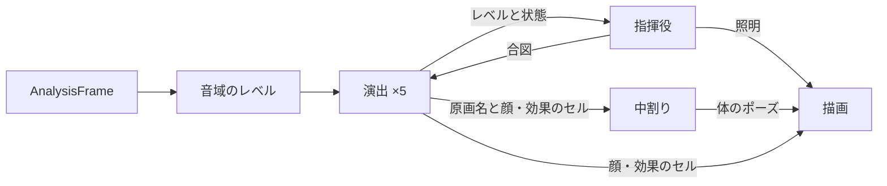

# オコジョ合唱団の実装設計

[設計書一覧](../README.md)に戻る。

## 1. 概要

オコジョ合唱団（表示名「MICRIGAIKE コジョーズ」）は、`LCMP_default_GEQ`のアニメーション領域で、蛍光管LEDと切り替えて表示する可視化デザインである。山の上の温泉のステージで、5匹のデフォルメされたオコジョが木箱の上に並び、それぞれが受け持つ音域のレベルに合わせて歌う。性格の違う動きと表情に加え、互いを見たり、そろって動いたりする連動で見せる。

画調は日本の手描きアニメ・漫画を基調とする。動きは、手で描いた原画を順に見せ、原画のあいだを中割りで埋める方式で作る。物理演算や連続関数による動きは使わない。

製品の仕様は[UI・UX設計](01_ui-ux-design.md#5-可視化デザインの構成)、Player UIへの組み込みは[開発ガイド](10_player-ui-developer-guide.md)に記載する。

## 2. 要件

### 外観

- 5匹を左から5・3・1・4・2の順（低音から高音）に、60pt間隔で寄り添って並べる。
- 背景は、オコジョたちが手作りした暗い舞台とする。山や天気などの風景は描かない。
  - 上端に木の梁を渡し、ピンクのネオン管の看板「MICRIGAIKE KOJOES」を梁から少し下げて紐で吊るす。看板はわずか（−2.5°）に傾ける。看板はふだん一定の明るさで光り、高音の強い立ち上がりで、ときどき1〜2文字が0.2秒ほど明滅する。ひとりでに点滅し続けることはない。
  - 梁の両端から缶の照明を吊るし、歌の音域（中音）に合わせて上から照らす。
  - 舞台の手前の両端に、ライブハウスの床置きの照明（スタンドに載った缶）を置き、低音に合わせて下から照らし上げる。ソロではその子を照らす。
  - 空気中には、ごく小さなホコリ（直径1pt未満、140粒）がゆっくり漂う。照明の光の筋の中だけで見え、光を受けた瞬間にきらめく。キャラクタと木箱より奥に描くので、暗い背景と光の筋の中にだけ現れる。
- 線はインクの色で描き、塗りは境目のはっきりした2色の影（セル影）とする。
- 頭は横長で上が平ら、目は小さい黒塗りの少しつぶれた楕円に反射点を1つ入れ、間を広く空ける。耳は小さく低い位置に置き、尻尾の先は黒くする。
- 前足は肩の外側の輪郭から出て、手先に近いほど急に細くなる。付け根には区切りの線を引かない。
- 茶色のオコジョは夏毛として、顎・喉・お腹を白くする。

| キャラクタ | 外観 | 受け持つ音域 | 性格の出し方 |
| --- | --- | --- | --- |
| 1 | 白 | 中音（500Hz〜2kHz） | 素直。ここぞという強い声で、数秒だけ背伸びして目をぎゅっと閉じ、汗をかきながら震える。ときどき手を差し出す |
| 2 | 薄茶、目の反射点が2つ | 高音（5kHz〜） | アクティブ。盛り上がると腰を振って踊り、ときどき後ろを向いて一回転する。右端に立つので尻尾を左に出す |
| 3 | 茶、黒縁眼鏡 | 中低音（150〜500Hz） | 真面目。眼鏡がときどき光る。盛り上がった強い音で腕を突き上げてジャンプし、ときどき4をチラ見する |
| 4 | クリーム、耳元の花、まつげ | 中高音（2〜5kHz） | 喜び・驚き・困りと表情が変わる。尻尾を振り、キラッのふり付けをする。1が熱唱すると困り顔で見守る |
| 5 | 茶、大柄、太眉 | 低音（〜150Hz） | 力こぶのポーズ。豪快に笑うときは、言葉ではなく低い音符（♩）を流す |

### 動き

- 拍（ビート）がわかるあいだは、全員が拍で小さく弾み、2拍ごとに同じ向きへ揺れる（合唱団のスウィング）。沈む絵を拍の直前に出し、伸びた絵が拍に重なるようにする。強い音域の1小節目（4拍ごと）は大きく沈む。拍がわからないときは、各自の音域の立ち上がりで弾む。
- 腕は、フレーズ（8拍、静かなときは16拍。拍がわからないときは4秒）ごとに意味のあるポーズを選んで保つ。ポーズは、胸の前で祈る（目を閉じる）・片手を差し伸べる・両手を広げる・片腕を頬の横まで上げて呼びかける・観客を指さす（ウインクを添える）・下ろす、の6つで、盛り上がりと性格で選ぶ。腕は首に対する位置で持ち、弾みと揺れについていく。拍ごとに腕を動かすことはしない。
- 得意の大きな動き（2の回転・3のジャンプ・5の力こぶ）は、拍の近くの音で始める。
- 体の動きは原画（体のセル）の切り替えで表す。表示は30fpsとし、原画のあいだは出だしと終わりをゆっくりにした中割りで埋める。
- 震えの交互・腕のブレ・後ろ姿への切り替えは、勢いを残すため中割りを入れずに切り替える。
- 目・口・汗・効果線・音符は、体の上に重ねるセルとして差し替える。口はレベルに応じた4枚の口パクとし、口の形だけは表示の毎コマ（30fps）でレベルに合わせる。
- 左右の揺れは小さくし、上下の弾み（沈む→伸びる）と表情の切り替えで歌を表す。歌っているあいだの表情（開いた目・にっこり・うっとり）の出やすさは、キャラクタごとに変える。
- 1の背伸びは、平均レベルが0.62を超えた強い音の立ち上がりで、3割の確率で始まる。2.5〜4秒で戻り、次は8〜14秒あける。歌の音域は多くの曲でいつも強いので、背伸びし続けないようにする。
- 動きを減らす設定では、体の原画を待機に固定し、表情と口パクだけを動かす。照明は一定の明るさにする。

### 連動

1匹ずつの動きに加え、全体を見る指揮役（`ErmineEnsemble`）が、複数のキャラクタを動かす。

| 連動 | 起きる条件 | 動き |
| --- | --- | --- |
| ソロと注目 | 1つの音域の平均レベルが、ほかの平均より0.3（1は0.42）以上高い状態が1.5秒続く。間隔は10秒以上 | その子が得意の動き（1背伸び・2回転・3ジャンプ・4キラッ・5力こぶと音符）を3秒し、ほかの子はその子の方を向いて笑顔で見る。照明はその子を照らす |
| ウェーブ | 全体のレベルが直近数秒の平均より0.3以上上がり、0.55を超える（サビに入るなど）。間隔は20秒以上 | 左から右へ順に、沈んで伸び上がる。続けて全員が外側の腕を上げ、8拍保つ |
| せーので跳ぶ | 全体が2秒以上静かだったあと、強い低音の立ち上がり。静けさが終わって3秒たつと取りやめる。間隔は12秒以上 | 全員がそろって沈み、跳び、着地する。ウェーブより優先する |
| お辞儀 | 歌っていたあと、再生中に1.2秒以上ほぼ無音になる。一時停止では行わない | 全員が目を閉じてお辞儀する |
| 掛け合い | 8〜14秒ごと、歌っているあいだ | 隣どうしが笑顔で顔を見合わせる |
| チラ見 | 3が4をチラ見したとき、半分の確率 | 4が気づいて3を見る。3は赤くなって目をそらす |
| お礼 | 1の背伸び（4が困り顔で見守る）が終わったとき | 1が4ににっこり笑い、4も笑い返す |

### 音域とレベル

- 解析は蛍光管LEDと同じ16帯域・30Hzを使う。各帯域を中心周波数で5つの音域へ振り分け、音域ごとにパワーを平均する。
- 音域ごとに直近の最大値に感度を合わせる。最大値は即座に上がり、毎秒1.5dBで下がる。最大値から30dB下を0、最大値を1とする。最大値は−60dBFSを下限とし、−80dBFS以下は無音として0にする。高音の弱い曲でも、全員が歌う。

## 3. 方式

構成するファイルは`Sources/PlayerUI/Players/Micrigaike_Kojoes/`にまとめる。デザインの種類（`VisualizationDesign`）・切り替え（`PlaybackVisualization`）・カードの枠（`VisualizationThumbnail`）は蛍光管LEDと共通の部品として、`LCMP_default_GEQ/Visualization/`に置く。

| 部品 | 責務 |
| --- | --- |
| `ErmineChorusKeys.swift` | 原画（`ErmineKey`）の数値と、中割り（`ErmineInbetweener`）、腕のポーズ（`ErmineArmPose`）とその中割り |
| `ErmineChorusBeat.swift` | 拍の推定（`ErmineBeatTracker`）と、全員で共有する拍（`ErmineBeat`） |
| `ErmineChorusCast.swift` | 5匹の毛色・体格・特徴・音域・表情の確率、顔と効果のセルの型、音域のレベル（`ErmineBandLevels`） |
| `ErmineChorusDirector.swift` | 演出。レベルと指揮役の合図から、どの原画をどれだけ止めるか、どの顔と効果のセルを重ねるかを決める |
| `ErmineChorusDust.swift` | 空気中のホコリの漂いときらめき |
| `ErmineChorusEnsemble.swift` | 指揮役。拍の数え方をそろえ、5匹のレベルを見て、ソロ・ウェーブ・せーので跳ぶ・お辞儀・掛け合いの合図と、照明とネオンの状態を決める |
| `ErmineChorusRenderer.swift` | 舞台・体・顔・効果のセルを、SwiftUIの`GraphicsContext`で重ねて描く |
| `ErmineChorusDriver.swift` | 30fpsの時計、提示待ち、寿命の管理 |
| `ErmineChorusView.swift` | Canvasと支援技術への公開 |
| `ErmineChorusThumbnail.swift` | 表示タブのカードに描く1の頭と胸 |



- 演出は毎秒12回、原画と止めを決める。中割りと描画は30fpsで動く。
- 原画・タイミング・表情の確率はデータとしてまとめ、実機で見ながら調整できるようにする。

## 4. 実装

### 原画と中割り

- 原画は、腰と胴の幅、首と頭の位置・回転・拡大率、前足の手先、尻尾のベジェ制御点、体の向き（`turn`）、肩の高さ、肘の曲がり、腰の振り、ジャンプの高さ、後ろ姿、腕を頭の後ろに描くかを持つ。
- 中割りは数値を補間し、イーズは`x < 0.5 ? 2x² : 1 − 2(1 − x)²`とする。通常は0.1秒、待機の呼吸どうしは0.5秒で移る。震えの交互・ブレ・後ろ姿の出入りは0秒とする。
- `turn`は胴の遠ざかる側を細くし、中心線と影と顔の部品を向いた側へ寄せる。腰は回転の半分だけ細くする。|turn|が0.7を超えると遠い側の目を隠す。

### 拍の推定

- 解析フレームごとに、低音・中低音の上昇量と中音の上昇量の半分を足して、音の立ち上がりの強さとする。直近6秒を30Hzに並べ直し、0.5秒ごとに推定する。
- 70〜180BPMの範囲で自己相関を求め、120BPM付近を少し優先して周期を選び、前後の値の放物線で補間する。周期で並べた櫛の和が最大になる位置を拍とする。
- 選んだ周期の自己相関が全周期の平均の1.8倍に満たなければ、拍はわからないものとして扱う。シーク・曲の切り替え（解析の世代の変更）では推定を捨てる。
- 推定の基準が動いても揺れの向きがそろうよう、指揮役が拍の数を増える方向だけに数え直して全員に渡す。

### 演出

- レベルは、立ち上がり35ms・減衰160msの包絡、350msの中間値、2.5秒の平均の3つに分ける。包絡が中間値を0.12上回り、前回から220ms以上空いたら、音の立ち上がりとする。
- 拍がわからないときは、立ち上がりで「沈む（1コマ）→伸びる（1コマ）→歌う（左右を交互）」へ進む。1コマは1/12秒である。拍がわかるときは、拍の1.5コマ前に「小さく沈む（1コマ）」を始め、拍に合わせて揃った向きの歌う原画へ移る。
- 1は平均が0.55を超えると背伸びに入り、0.44を下回ると戻る。ほかの4匹は、平均0.5で盛り上がり、0.4で落ち着く。
- 4は、1が背伸びしているあいだ1の方を向き、困り眉で見守る。3は6〜13秒ごとに4の方をチラ見する。
- 乱数はキャラクタごとに固定の種から作り、テストで再現できるようにする。

### 描画

- 舞台は、背景・吊るした照明の光と灯体・木の梁・ネオンの看板・床の照明の光と灯体・ホコリ・木箱・木箱に落ちる光の輪・キャラクタの順に描く。
- ホコリは毎秒0.1〜1.4pt上へ、横へ±1.2ptの範囲でふらつきながら漂い、上端から出たら下端の別の位置へ戻る。明るさは、ホコリがある位置での各照明の光（光の筋の内側だけ、筋の先ほど弱い）の和に、きらめき（`0.25 + 0.75 × ((1 + sin φ) / 2)^6`）を掛けたものとする。明るい粒には淡い光の輪を添える。動きを減らす設定では描かない。
- ネオンは文字ごとに描き、明滅中の文字は消えた管の色（くすんだピンク）にする。動きを減らす設定では明滅させず、照明も一定の明るさにする。
- 指さしでは、手先の先に小さな指を描き、指す側の目を閉じる（ウインク）。
- キャラクタの描画の順序は、尻尾・足・胴・（上げた前足）・耳・頭・顔の白い模様・（胸の前の前足）・顔・効果とする。後ろ姿では、顔と前足を描かず、尻尾を胴の手前に描く。
- 前足は2次ベジェで、太さを`r1 + (r0 − r1)(1 − t^2.4)`とする。付け根の辺には線を引かず、内側の線は55%の位置から引く。
- 360×144の舞台をビューの大きさに合わせて拡大し、中央に置く。右端の2は尻尾を左に出し、舞台からはみ出さないようにする。

### 時計と寿命

- `ErmineChorusDriver`は、表示中かつ再生中のあいだ33ms周期で進む。描画内から再生や解析を開始しない。
- 解析結果は、LED表示と同じ先読みの幅だけ推定提示時刻より前まで待ってから使う（最大64件）。拍の位相も同じだけ先の時刻で求める。無効な提示時刻は即時に使う。同じ世代の古い連番は捨て、世代が変わったら待ちと感度を捨てる。
- 250ms以上更新がなければ、全員の口を閉じ、「解析データを待っています」を表示する。
- 一時停止では待ちを捨て、1.2秒で待機の姿勢へ落ち着いてから時計を止める。停止と非表示では直ちに時計を止め、全員を待機の原画へ戻す。シークなどの`reset()`では、待ちと感度を捨てる。

## 5. 検証

### 自動テスト

`Tests/PlayerUITests/Players/Micrigaike_Kojoes/ErmineChorusTests.swift`で次を確かめる。

- 全原画の定義、上げた前足が頭の後ろに回ること、中割りのイーズとカット。
- 16帯域から5つの音域への振り分け、音域ごとの感度、無音とノイズで歌わないこと。
- 演出：立ち上がりで沈む→伸びる→歌う、1の背伸びが数秒で終わって間をあけること、4の見守り、3のジャンプの条件、合図（跳ぶ・お辞儀・照れる）、動きを減らす設定、一時停止で口を閉じること。
- 連動：目立つ音域のソロとほかの子の注目、歌の音域が少し強いだけではソロにならないこと、左から右へのウェーブと続く腕上げ、静けさのあとのそろったジャンプ、曲の終わりのお辞儀（一時停止ではしない）、低音・歌に合わせた照明、高音でだけ起きるネオンの明滅。
- 拍：90・120・150BPMの周期と拍の位置、雑音では拍としないこと、拍の数が増える方向だけに進むこと。
- ノリ：全員が拍で同じ向きに揺れ、沈む絵が拍の直前に出ること、腕のポーズがフレーズ単位で変わること、腕が弾みについていくこと、指さしのウインク、口が毎コマ変わること。
- 時計：提示待ちの採用、データの欠落、一時停止後の停止、停止・非表示での停止と解放、デザインの保存と切り替え。
- ホコリ：ゆっくり漂って舞台の空間に留まること、光の筋の中だけが照らされること、照明が消えているときと動きを減らす設定では見えないこと。
- 描画：5匹と木箱と毛色・看板・照明の画素、ソロの照明が足元を照らすこと、全原画と全セルを重ねた描画、5匹の描画命令が1コマ12ms未満であること。
- 表示タブ：カードの描画と、選んだカードに緑の枠が移ること（`NativeViewTests.swift`）。

### 画像による確認

次のコマンドで、待機・合唱中・ソロの照明・全原画の画像と、表示タブのカードを保存する。

```sh
LCMP_UI_SNAPSHOTS=build/ermine-qa \
./scripts/swift.sh test --disable-automatic-resolution --no-parallel --filter 'ErmineChorus|VisualizationDesignCard'
```

## 6. 参照

- [可視化の実装設計](08_visualization-implementation.md)：解析結果の提示時刻と寿命の共通の考え方。
- [Player UI・可視化の開発ガイド](10_player-ui-developer-guide.md)：可視化デザインの切り替えと配置。
