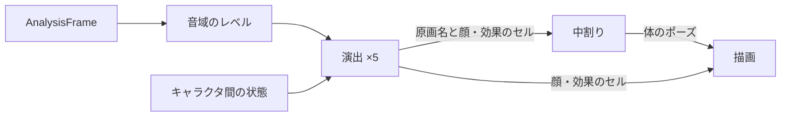

# オコジョ合唱団の実装設計

[設計書一覧](../README.md)に戻る。

## 1. 概要

オコジョ合唱団は、`LCMP_default_GEQ`のアニメーション領域で、蛍光管LEDと切り替えて表示する可視化デザインである。5匹のデフォルメされたオコジョが木箱の上に並び、それぞれが受け持つ音域のレベルに合わせて歌い、性格の違う動きと表情を見せる。

画調は日本の手描きアニメ・漫画を基調とする。動きは、手で描いた原画を順に見せ、原画のあいだを中割りで埋める方式で作る。物理演算や連続関数による動きは使わない。

外観と動きの見本は[オコジョ合唱団のモック](../../prototypes/ermine-chorus.html)にある。製品の仕様は[UI・UX設計](01_ui-ux-design.md#5-可視化デザインの構成)、Player UIへの組み込みは[開発ガイド](10_player-ui-developer-guide.md)に記載する。

## 2. 要件

### 外観

- 5匹を左から2・3・1・4・5の順に、60pt間隔で寄り添って並べる。背景は暗い地にスポットライトを当てた舞台とし、山や天気などの背景は描かない。
- 線はインクの色で描き、塗りは境目のはっきりした2色の影（セル影）とする。
- 頭は横長で上が平ら、目は小さい黒塗りの少しつぶれた楕円に反射点を1つ入れ、間を広く空ける。耳は小さく低い位置に置き、尻尾の先は黒くする。
- 前足は肩の外側の輪郭から出て、手先に近いほど急に細くなる。付け根には区切りの線を引かない。
- 茶色のオコジョは夏毛として、顎・喉・お腹を白くする。

| キャラクタ | 外観 | 受け持つ音域 | 性格の出し方 |
| --- | --- | --- | --- |
| 1 | 白 | 中音（500Hz〜2kHz） | 素直。熱唱では背伸びして目をぎゅっと閉じ、汗をかきながら震える。ときどき手を差し出す |
| 2 | 薄茶、目の反射点が2つ | 高音（5kHz〜） | アクティブ。盛り上がると腰を振って踊り、ときどき後ろを向いて一回転する |
| 3 | 茶、黒縁眼鏡 | 中低音（150〜500Hz） | 真面目。眼鏡がときどき光る。盛り上がった強い音で腕を突き上げてジャンプし、ときどき4をチラ見する |
| 4 | クリーム、耳元の花、まつげ | 中高音（2〜5kHz） | 喜び・驚き・困りと表情が変わる。尻尾を振り、キラッのふり付けをする。1が熱唱すると困り顔で見守る |
| 5 | 茶、大柄、太眉 | 低音（〜150Hz） | 力こぶのポーズと、描き文字の「ワハハ」で豪快に笑う |

### 動き

- 体の動きは原画（体のセル）の切り替えで表す。表示は30fpsとし、原画のあいだは出だしと終わりをゆっくりにした中割りで埋める。
- 震えの交互・腕のブレ・後ろ姿への切り替えは、勢いを残すため中割りを入れずに切り替える。
- 目・口・汗・効果線・音符・描き文字は、体の上に重ねるセルとして差し替える。口はレベルに応じた4枚の口パクとする。
- 左右の揺れは小さくし、上下の弾み（沈む→伸びる）と表情の切り替えで歌を表す。歌っているあいだの表情（開いた目・にっこり・うっとり）の出やすさは、キャラクタごとに変える。
- 動きを減らす設定では、体の原画を待機に固定し、表情と口パクだけを動かす。

### 音域とレベル

- 解析は蛍光管LEDと同じ16帯域・30Hzを使う。各帯域を中心周波数で5つの音域へ振り分け、音域ごとにパワーを平均する。
- 音域ごとに直近の最大値に感度を合わせる。最大値は即座に上がり、毎秒1.5dBで下がる。最大値から30dB下を0、最大値を1とする。最大値は−60dBFSを下限とし、−80dBFS以下は無音として0にする。高音の弱い曲でも、全員が歌う。

## 3. 方式

| 部品 | 責務 |
| --- | --- |
| `ErmineChorusKeys.swift` | 原画（`ErmineKey`）の数値と、中割り（`ErmineInbetweener`） |
| `ErmineChorusCast.swift` | 5匹の毛色・体格・特徴・音域・表情の確率、顔と効果のセルの型、音域のレベル（`ErmineBandLevels`） |
| `ErmineChorusDirector.swift` | 演出。レベルから、どの原画をどれだけ止めるか、どの顔と効果のセルを重ねるかを決める |
| `ErmineChorusRenderer.swift` | 舞台・体・顔・効果のセルを、SwiftUIの`GraphicsContext`で重ねて描く |
| `ErmineChorusDriver.swift` | 30fpsの時計、提示待ち、寿命の管理 |
| `ErmineChorusView.swift` | Canvasと支援技術への公開 |



- 演出は毎秒12回、原画と止めを決める。中割りと描画は30fpsで動く。
- 原画・タイミング・表情の確率はデータとしてまとめ、実機で見ながら調整できるようにする。

## 4. 実装

### 原画と中割り

- 原画は、腰と胴の幅、首と頭の位置・回転・拡大率、前足の手先、尻尾のベジェ制御点、体の向き（`turn`）、肩の高さ、肘の曲がり、腰の振り、ジャンプの高さ、後ろ姿、腕を頭の後ろに描くかを持つ。
- 中割りは数値を補間し、イーズは`x < 0.5 ? 2x² : 1 − 2(1 − x)²`とする。通常は0.1秒、待機の呼吸どうしは0.5秒で移る。震えの交互・ブレ・後ろ姿の出入りは0秒とする。
- `turn`は胴の遠ざかる側を細くし、中心線と影と顔の部品を向いた側へ寄せる。腰は回転の半分だけ細くする。|turn|が0.7を超えると遠い側の目を隠す。

### 演出

- レベルは、立ち上がり35ms・減衰160msの包絡、350msの中間値、2.5秒の平均の3つに分ける。包絡が中間値を0.12上回り、前回から220ms以上空いたら、音の立ち上がりとする。
- 立ち上がりでは「沈む（1コマ）→伸びる（1コマ）→歌う（左右を交互）」へ進む。1コマは1/12秒である。
- 1は平均が0.55を超えると背伸びに入り、0.44を下回ると戻る。ほかの4匹は、平均0.5で盛り上がり、0.4で落ち着く。
- 4は、1が背伸びしているあいだ1の方を向き、困り眉で見守る。3は6〜13秒ごとに4の方をチラ見する。
- 乱数はキャラクタごとに固定の種から作り、テストで再現できるようにする。

### 描画

- 描画の順序は、尻尾・足・胴・（上げた前足）・耳・頭・顔の白い模様・（胸の前の前足）・顔・効果とする。後ろ姿では、顔と前足を描かず、尻尾を胴の手前に描く。
- 前足は2次ベジェで、太さを`r1 + (r0 − r1)(1 − t^2.4)`とする。付け根の辺には線を引かず、内側の線は55%の位置から引く。
- 360×144の舞台をビューの大きさに合わせて拡大し、中央に置く。右端の5は尻尾を左に出し、舞台からはみ出さないようにする。

### 時計と寿命

- `ErmineChorusDriver`は、表示中かつ再生中のあいだ33ms周期で進む。描画内から再生や解析を開始しない。
- 解析結果は推定提示時刻まで待ってから使う（最大64件）。無効な提示時刻は即時に使う。同じ世代の古い連番は捨て、世代が変わったら待ちと感度を捨てる。
- 250ms以上更新がなければ、全員の口を閉じ、「解析データを待っています」を表示する。
- 一時停止では待ちを捨て、1.2秒で待機の姿勢へ落ち着いてから時計を止める。停止と非表示では直ちに時計を止め、全員を待機の原画へ戻す。シークなどの`reset()`では、待ちと感度を捨てる。

## 5. 検証

### 自動テスト

`Tests/PlayerUITests/Players/LCMP_default_GEQ/Visualization/ErmineChorusTests.swift`で次を確かめる。

- 全原画の定義、上げた前足が頭の後ろに回ること、中割りのイーズとカット。
- 16帯域から5つの音域への振り分け、音域ごとの感度、無音とノイズで歌わないこと。
- 演出：立ち上がりで沈む→伸びる→歌う、1の背伸びの出入り、4の見守り、3のジャンプの条件、動きを減らす設定、一時停止で口を閉じること。
- 時計：提示待ちの採用、データの欠落、一時停止後の停止、停止・非表示での停止と解放、デザインの保存と切り替え。
- 描画：5匹と木箱と毛色の画素、全原画と全セルを重ねた描画、5匹の描画命令が1コマ12ms未満であること。

### 画像による確認

次のコマンドで、待機・合唱中・全原画の画像を保存する。

```sh
LCMP_UI_SNAPSHOTS=build/ermine-qa \
./scripts/swift.sh test --disable-automatic-resolution --no-parallel --filter ErmineChorus
```

## 6. 参照

- [オコジョ合唱団のモック](../../prototypes/ermine-chorus.html)：原画・表情・演出の見本。`?t=秒`で模擬の再生を止めて表示する。
- [可視化の実装設計](08_visualization-implementation.md)：解析結果の提示時刻と寿命の共通の考え方。
- [Player UI・可視化の開発ガイド](10_player-ui-developer-guide.md)：可視化デザインの切り替えと配置。
