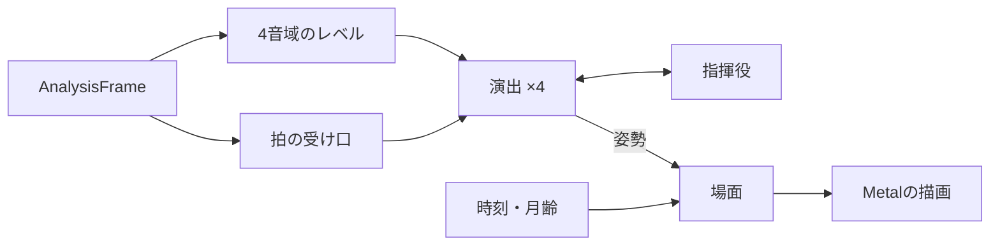

# 教育番組（パペット）の実装設計

[設計書一覧](../README.md)に戻る。

## 1. 概要

教育番組（表示名「教育番組」）は、`LCMP_default_GEQ`のアニメーション領域で、ほかの可視化デザインと切り替えて表示するデザインである。ペーパークラフト調の風景の前で、布でできた4体のパペットが曲の拍に合わせて歌う。背景は再生にあわせて朝・昼・夕・夜と移り変わり、風景がゆっくり横へ流れる。

パペットは3Dで組み立て、陰影は控えめにする。絵は生成AIで作った原画から部品を切り出して使う。描画はMetalで行う。

製品の仕様は[UI・UX設計](01_ui-ux-design.md#5-可視化デザインの構成)、Player UIへの組み込みは[開発ガイド](10_player-ui-developer-guide.md)に記載する。

## 2. 要件

### 舞台

- 360×144ptの舞台を、ビューに収まるよう拡大して中央に置く。
- 層は奥から、空 → 動く物（星・流れ星・彗星・太陽・月・雲・鳥・飛行機）→ 風景 → パペットとする。
- 時間は再生中だけ一定の速さで進み、6分で1日とする。停止・一時停止では進めず、停止しても時刻は保つ。
- 空の色は、朝・昼・夕・夜の参考の絵から拾った上端と地平線の色（左・中・右）を、時刻の重みで混ぜる。
- 太陽と月は、風景の裏まで沈みきる弧を描く。太陽は低いほど赤く暗くなり、地平線の近くでは周りの空を淡く染める。月は実際の日付の月齢で欠け、新月の前後は見えない。
- 夜は星が小さく光り、ときどき1つずつ瞬く。ときどき短い尾を引く流れ星と、まれに彗星が左から右へ流れる。
- 雲は4つで、それぞれ形を1つに決めて時刻の色を掛け、紙の影を落とす。奥の雲ほど小さく遅い。
- 昼のあいだ、ときどき鳥と飛行機が横切る。飛行機は機首の向きへ進む。
- 風景は朝・昼・夕・夜の4枚を時刻の重みで重ね、1日で1周横へ流れる。4枚は富士山の頂とたき火の位置で昼の絵に合わせる。

### パペット

左から次の順に並ぶ。歌のないところでは、口を開くタイミングを全員が拍とし、開く量はそれぞれが受け持つ音域の強さで決める。歌のあるところでの配役と反応は「方式」に記載する。

| 位置（pt） | キャラクタ | 受け持つ音域 | 目の光り方 | 性格・掛け合い |
| --- | --- | --- | --- | --- |
| 50 | ツインテール | 高音（4kHz〜） | 落ち着いた蒼。音量と拍でわずかに明滅し、拍ごとに輪が広がる | 面倒見がよく恥ずかしがり屋。ツンツン髪とメガネくんの様子を見ていて、気づかれると目を閉じ、頬を赤らめて震える |
| 136 | ツンツン髪 | 低音（〜250Hz） | ゆらめく赤い炎 | 陽気な人気者。メガネくんをよく見る。強い音が続くとヘッドバンギングする |
| 224 | メガネくん | 中低音（250Hz〜1kHz） | Last Century イコライザーの緑のLED | ツンツン髪やポニーテールと目が合う |
| 310 | ポニーテール | 中高音（1〜4kHz） | 暗めの落ち着いたピンク | メガネくんをチラチラ見る。目が合うとそっぽを向き、頬を赤らめて目が光る |

- 頭は肌の色の楕円体に布の質感（織り目・毛羽・左右の縁の縫い目）を付け、眼鏡と目だけを縁をぼかしたシールで貼る。唇は描かない。
- 髪は顔より一回り大きい楕円体で、前は髪の絵を正面から投影し、後ろは髪の色とする。球からはみ出す髪（毛先・ツインテール・ポニーテール・リボン）は頭の中心の面に置いた板とし、口より下へ垂れる髪は体と腕の後ろへ回す。
- 口は頭の水平の切れ込みで、上あごを後ろへ反らせ、下あごを少し下げて開く。中に上あごと舌の面が見える。口を閉じたときに切れ込みの線は見せない。
- 首は頭と胴にめり込ませた短い円柱で、顎の影で暗くする。腕は袖ごとの部品で胴より手前に置き、付け根が見えない小さな幅で動かす。
- 体は拍で沈み、2拍ごとに左右へ小さく揺れる。腕のポーズ（そのまま・上げる・広げる・下げる）と向きは、フレーズ（8拍、拍がわからないときは4秒）ごとに選ぶ。ツインテールとポニーテールは、フレーズの始めにときどき同じ振り付けをする。
- アクション：目が輝く（急な盛り上がり）、シャウト（いちばん強い盛り上がり。伸び上がって上を向き、口を限界まで開けて震え、目を><につぶり、頭のまわりに叫びの線）、ヘッドバンギング、恥ずかしい（目を閉じ、頬を赤らめて震える）、頬を赤らめる、泣く（頬を流れる涙の筋）、ぐったり（再生中に鳴り止んだとき）。
- パペットには時刻の光の色を掛ける（夕方は赤み、夜は青み）。
- 動きを減らす設定では、体の弾み・揺れ・ヘッドバンギング・震えを止め、口と表情と目だけで歌う。流れ星と彗星は出さず、星は瞬かない。

## 3. 方式

構成するファイルは`Sources/PlayerUI/Players/Kyouiku_Bangumi/`にまとめる。デザインの種類・切り替え・カードの枠は、ほかのデザインと共通の部品（`LCMP_default_GEQ/Visualization/`）を使う。

| 部品 | 責務 |
| --- | --- |
| `PuppetShowCast.swift` | 4体の並び・音域・目の光り方・肌の色の調整、16帯域から4音域へのまとめと感度 |
| `PuppetShowDirector.swift` | 1体ずつの演出。音域の強さと拍から、弾み・揺れ・口・腕・向き・アクションを決め、姿勢（`PuppetPose`）を作る |
| `PuppetShowEnsemble.swift` | 指揮役。視線と掛け合い、同じ振り付けを決める |
| `PuppetShowBackdrop.swift` | 背景の時刻と月齢から、描く層（空・星・太陽・月・雲・風景など）を決める |
| `PuppetShowRig.swift` | パペットの組み立て（形・部品の親子関係・材質）と、姿勢の当てはめ |
| `PuppetShowPatterns.swift` | コードで描く絵（布の質感・口の中・目の光・涙・頬・紙の粒・雲の影など） |
| `PuppetShowArt.swift` | 同梱の絵と`characters.json`の読み込み |
| `PuppetShowArtwork.swift` | 絵と組み立てを裏のスレッドで用意し、描画部を一度だけ作る（`PuppetShowLoader`） |
| `PuppetShowRenderer.swift`・`PuppetShowShaders.swift` | Metalでの描画。背景は舞台の座標の2D、パペットは3D |
| `PuppetShowDriver.swift` | 30fpsの時計、提示待ち、拍の受け口と曲の地図、時刻の進行、寿命の管理 |
| `PuppetShowVocals.swift` | その時刻のボーカル（`PuppetVocal`）と、歌う人の配役（`PuppetCasting`） |
| `PuppetShowView.swift` | `MTKView`の表示と支援技術への公開 |
| `PuppetShowThumbnail.swift` | 表示タブのカードの絵（メガネくんの顔）。同梱の`Art/thumbnail.png`を表示し、舞台から切り出して作る方法も持つ |



- 拍とボーカルは、前処理で求めた曲の地図（`receive(trackMap:)`）から、解析フレームの曲の秒（`trackSeconds`）で引く。地図がない・拍が不明確・曲の位置がわからないときは、拍を`PuppetBeatSource`の口（オコジョ合唱団と同じ再生中の推定`ErmineBeatTracker`）から得る。
- 歌のある曲では、曲ごとにリードを1人決め、区切りごとにほかの役を配り直す（`PuppetCasting`、`PuppetShowVocals.swift`）。役は、リード（ボーカルの口の開きで歌い、ハイトーン・ロングトーンを演じる）・サブ（小さく一緒に歌い、ハモりでは大きく歌う）・拍（拍で歌う）・口ずさみ（拍で小さく歌う）の4つで、受け持つ音域も役と一緒に入れ替える。条件と数値は[曲の地図の実装設計](15_track-map-implementation.md#再生中の使い方教育番組)に記載する。
- 演出と背景の計算は描画から切り離した値（`PuppetPose`、`PuppetBackdrop.Layer`）として作り、描画部はそれを描くだけにする。

### 素材

- 原画は`assets/puppet-show/puppets.png`（4体を並べた1934×596の絵）である。`scripts/make-puppet-parts.py`が、髪・目のシール・胴・左右の腕・はみ出す髪を切り出し、頭の楕円・目・切れ込み・首と腕の付け根などの数値とともに`Players/Kyouiku_Bangumi/Art/`へ書き出す。座標は原画の画素で書く。
- 背景の絵（風景4枚・太陽・月・彗星・雲4つ・鳥・飛行機）は、そのまま`Art/`に置く。
- カードの絵`Art/thumbnail.png`は、描画部で朝の舞台を描き、メガネくんの顔を224×168ピクセルで切り出したものである。起動直後でもすぐ表示できるよう同梱する。PNGには付加情報（EXIF・解像度）を入れない。
- `Art/`は`PlayerUI`ターゲットのリソースとして、パッケージのリソースのバンドル（`LCMP_PlayerUI.bundle`）に入る。macOSのアプリではContents/Resourcesに、iPhoneのアプリでは直下に置かれ、`PuppetShowArt`は両方を探す。
- 絵を作り直すには次を実行する。

```sh
uv run --with pillow --with numpy python -I scripts/make-puppet-parts.py
```

## 4. 実装

### 座標と描画

- 1画素の原画は0.185ptで描く。頭は1.14倍にして、顎の下の襟まわりを隠す。
- 舞台は幅360・高さ144pt、パペットはy上向きの3Dの座標に置き、視野角12°のカメラが舞台の中央を正面から見る。隣どうしは奥行きを4ptずらす。
- 動きの数値はモックアップ（three.js）で調整した値をそのまま使い、回転の順序（X・Y・Z）と行列の掛け方（平行移動・回転・拡大）も合わせる。
- 描画は4倍のマルチサンプルで行う。部品の絵の縁はアルファでの切り抜き（0.45）とカバレッジで滑らかにする。
- パペットの絵はsRGBからリニアに直して頂点の色・光の色と掛け、sRGBに戻して書く。背景の絵は2Dのキャンバスと同じく、sRGBの値のまま重ねる。
- 半透明の部品は、描く順（シール5、目の芯10、目の光11、涙・頬・輪12、閉じた目・叫びの線13）と奥からの順で描く。顔の上の効果は奥行きの判定をせずに最後に描く。目の光と輪は加算で重ねる。
- 口の中の面は、頭の切れ込みの輪と同じ角（9°ごと）の半円とし、頭の面から外へ出さない。

### 背景

- 時刻の重みは、朝・昼・夕・夜の中心（0・0.25・0.5・0.75）からの距離のsmoothstep（0.17〜0.08）を合計1にしたものとする。
- 空は上端の色から地平線の色へ、高さの0.6で地平線の色に達する。
- 風景は横に繰り返せるよう、絵の右端の13%を左端に重ねて混ぜる。目印の位置合わせ・重ね・紙の粒は描画のときに行い、元の絵は加工せずに持つ。macOSでは風景を半分の解像度で読む（表示は高さ約216ピクセル）。
- 雲の影は、雲のアルファを1.5ptのガウスでぼかしたもの（1/4の解像度で作る）を、1.2pt下へずらして描く。
- 月は、輪郭と明暗の境目（楕円）の内側を計算で塗り、影と紙の粒を重ねる。月齢は朔望月（29.530588853日）で求める。
- 乱数はモックアップと同じ32ビットの線形合同法とし、星の配置・布の模様・選択がモックアップと一致する。

### 演出

- 音域のレベルは、直近の最大値に合わせる（即座に上がり、毎秒1.5dBで下がる。最大値から30dB下を0、最大値を1、−80dBFS以下は0）。
- レベルは速い包絡（立ち上がり12ms・減衰60ms）と遅い包絡（80ms・350ms）、全体の中間値（350ms）と平均（2.5秒）に分ける。
- 拍がわかるときは、拍の位相のガウス（幅0.1）で沈み、拍の少し後（+0.04）を中心にしたガウス（幅0.13）で口を開く。拍がわからないときは、速い包絡と遅い包絡の差で弾み、口を開く。
- 口の開きは`clamp(1.25 × 遅い包絡 × (0.25 + 0.75 × 拍) + 0.6 × 細かい立ち上がり)`で、ぐったりと恥ずかしいときは小さくする。
- 盛り上がりの判定は、音が鳴り始めて5秒たってから行う（曲の頭の大きな音を盛り上がりとしない）。シャウトは中間値0.72超かつ平均より0.18上で2.2秒（次は14秒あける）、目が輝くのは中間値0.62超かつ平均より0.16上で1.8秒（次は10秒）。ツンツン髪は目の輝きが0.08ゆるい。ヘッドバンギングは拍がわかり平均0.5超で8拍（次は16秒）。
- 笑顔（頬を赤らめ、目を半分ほど細める）は、平均0.25超のフレーズ（8拍）の始めに、リード以外が6割の確率で2.4秒見せる（次は6秒あける）。
- だれかが叫び始めたら（残りが1.2秒を超えるうち）、ぐったり・恥ずかしい・ヘッドバンギングでないほかの全員が、残りの時間だけ一緒に叫ぶ（指揮役）。ぐったりは再生中に全体が1.2秒以上ほぼ無音のときで、一時停止では行わない。
- 動きはばね（臨界減衰）で目標へ寄せる。
- 指揮役は、ツンツン髪を6〜11秒ごと、ポニーテールを5〜9秒ごと、ツインテールを7〜12秒ごとに動かす。相手がシャウト・ヘッドバンギング・恥ずかしい・ぐったりのときや、すでにどこかを見ているときは、見る相手にしない。

### 時計と寿命

- `PuppetShowDriver`は、表示中かつ再生中のあいだ33ms周期で進む。解析結果は推定提示時刻より少し前（ほかのデザインと同じ先読み）まで待ってから使い（最大64件）、拍の位相も同じ時刻で求める。
- 拍の数は増える方向だけに数え、推定が動いても2拍ごとの揺れの向きがそろうようにする。
- 250ms以上更新がなければ全員の口を閉じ、「解析データを待っています」を表示する。
- 一時停止では待ちを捨て、パペットが落ち着くまで（最長1.5秒）時計を動かしてから止める。停止と非表示では直ちに止め、全員を待機の姿勢へ戻す。時刻と再生の経過時間は残す。シークなどの`reset()`では、待ち・感度・拍を捨てる。
- 絵と組み立ては、最初に表示するときに、裏のスレッドで一度だけ用意する。表示タブのカードは同梱の絵を使い、舞台を読み込まない。用意ができるまでは朝の空の色だけを表示する。Metalや絵が使えないときも同じ表示にする。
- `MTKView`は止めたままにし、driverが新しい場面を出したときだけ描く。

## 5. 検証

### 自動テスト

`Tests/PlayerUITests/Players/Kyouiku_Bangumi/`で次を確かめる。

- 音域：16帯域が4つの音域に3つ以上ずつ入ること、音域ごとの感度、無音と不正な値。
- 演出：口が拍で開き拍のあいだで閉じること、再生中の無音でぐったりし一時停止ではしないこと、シャウトと目の輝きの条件と間隔、ヘッドバンギングはツンツン髪だけで拍がわかるときだけであること、腕と向きがフレーズの境目でだけ変わること、動きを減らす設定、目の光り方。
- 指揮役：視線の向き、目が合ったポニーテールが頬を赤らめ目が光ること、ツインテールの恥ずかしがり、同じ振り付け。
- 背景：時刻の重み、昼の太陽と夜の月・星、新月で月が見えないこと、雲の流れと範囲、鳥、動きを減らす設定、月齢と暦。
- 組み立て：口の中の面の角が頭の輪の角と一致すること、部品がそろうこと、絵が切り詰められていること、姿勢の当てはめ。
- 時計：提示待ち、時刻が再生中だけ進むこと、データの欠落、一時停止後の停止、停止・非表示での停止と解放、拍の受け口の差し替えと数え方、曲の地図と再生中の推定の切り替え、配役とボーカルへの反応、デザインの保存と切り替え。
- 描画：朝・昼・夕・夜と、模擬の曲（118BPM）と各アクションの画像（`PuppetShowRenderingTests`）。同梱のカードの絵が、今の描画部で描いた絵と一致すること（平均の差0.1未満。同じGPUでは0で、肌の色を少し変えると約0.26になる）。
- 表示タブ：舞台を読み込まずに、3枚目のカードにメガネくんの顔が出ること（`NativeViewTests.swift`）。

### 画像による確認

次のコマンドで、時刻ごとの舞台・模擬の曲・各アクションの画像を保存する。モックアップの`?t=秒&tod=時刻&solo&fx=アクション`と同じ条件で描くので、並べて比べられる。

```sh
LCMP_UI_SNAPSHOTS=build/puppet-qa \
./scripts/swift.sh test --disable-automatic-resolution --no-parallel --filter PuppetShowRenderingTests
```

### カードの絵の作り直し

パペットの見た目を変えたら、次のコマンドでカードの絵を作り直す。作り直さないと、上の一致のテストが失敗する。

```sh
LCMP_PUPPET_WRITE_THUMBNAIL=1 ./scripts/swift.sh test --disable-automatic-resolution --no-parallel \
  --filter theBundledCardPictureMatchesTheStage
```

### 負荷の測定

読み込みの時間・テクスチャの量・1フレームのCPUとGPUの時間（Macのウィンドウと、iPhoneの横向きの全画面の大きさ）を、リリース構成で測る。

```sh
LCMP_PUPPET_PERF=1 ./scripts/swift.sh test -c release --disable-automatic-resolution --filter PuppetShowPerformanceTests
```

## 6. 参照

- [可視化の実装設計](08_visualization-implementation.md)：解析結果の提示時刻と寿命の共通の考え方。
- [オコジョ合唱団の実装設計](12_ermine-chorus-implementation.md)：拍の推定。
- [Player UI・可視化の開発ガイド](10_player-ui-developer-guide.md)：可視化デザインの切り替えと配置、リソースの置き方。
