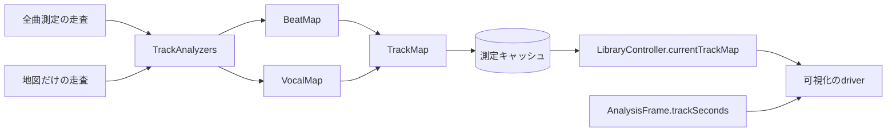

# 曲の地図（拍とボーカル）の実装設計

[設計書一覧](../README.md)に戻る。

## 1. 概要

再生の前に、曲全体の拍（ビート）とリードボーカルの動きを求め、曲の地図（`TrackMap`）として測定キャッシュへ保存する。再生中は、可視化が地図を曲の位置で引き、曲の頭から拍に乗り、歌い方に合わせて動く。

- 地図は、拍の地図（`BeatMap`）とボーカルの地図（`VocalMap`）からなる。
- 解析は、[再生前処理](04_preprocessing-implementation.md)の全曲測定と同じ走査で行う。
- 地図は[永続キャッシュ](05_measurement-cache-implementation.md)に、測定値とは別の記録として保存する。
- 再生中の拍の推定（[オコジョ合唱団の拍の推定](12_ermine-chorus-implementation.md#拍の推定)）は、地図がない曲や拍がはっきりしない曲で使う。

## 2. 要件

- 時刻は曲の頭からのミリ秒で表す。
- 拍の検出とボーカルの解析の方式は、呼び出し側とキャッシュの読み書きを変えずに差し替えられる。どちらかの方式・版が変われば、その曲の地図だけを作り直し、音量の測定値は測り直さない。
- 拍の地図には、方式の版・曲の長さ・拍の明確さ・テンポの区間・拍（時刻・強さ・小節の頭）を持つ。
- ボーカルの地図には、方式の版・音域・音程の中央値・口の開きと音程の時系列・出来事（フレーズ・ロングトーン・ハイトーン・シャウト・ハモり）を持つ。
- 前処理の負荷と電力を大きく増やさない。全曲測定に解析を足しても、デコードは1回で済ませる。
- 地図がない・拍が不明確・曲の位置がわからないときは、可視化は再生中の推定へ戻る。

## 3. 方式

| 要素 | 担当 |
| --- | --- |
| `TrackMap`（AudioProcessingCore） | 拍とボーカルの地図をまとめ、1つの記録に符号化する |
| `BeatMap`・`VocalMap`（AudioProcessingCore） | それぞれの地図。時刻からの引き当て、バイナリへの符号化と検証 |
| `BeatDetecting`・`VocalAnalyzing`（AudioProcessingCore） | 解析の口。PCMを順に受け取り、最後に地図を返す。`algorithm`で方式と版を名乗る |
| `OnsetBeatDetector`・`CentreVocalAnalyzer`（AudioProcessingCore） | 標準の解析器 |
| `TrackAnalyzers` | 走査ごとに2つの解析器を作り、同じPCMを渡す。`MeasurementCacheConfiguration.trackAnalyzers`で差し替える（既定は`.standard`） |
| `AudioPreprocessor.trackMap` | キャッシュの照合、同じ音源の全曲測定への合流、地図だけの走査 |
| `LibraryController.currentTrackMap` | 再生中の曲の地図を公開する |
| `PlaybackVisualization`・`PlayerVisualizationDriver.receive(trackMap:)` | 地図を表示中のデザインのdriverへ渡す |
| `AnalysisFrame.trackSeconds` | 解析の窓の中央が曲の何秒目かを示し、地図の時刻と再生を対応させる |



- 全曲測定（`measureLevels`）の走査は、出力profileへ変換したPCMを、音量の測定と同じ順に解析器へも渡す。完了すると、測定値と地図をそれぞれ保存する。解析器の失敗は測定値を失敗にしない。片方の解析器が失敗した走査では地図を作らない。
- `trackMap`は、キャッシュに地図があれば返す。同じ音源の全曲測定が進行中なら、その走査に合流して完了を待つ。どちらもなければ、音源のレートのまま地図だけを走査する。合流した要求も走査を続ける理由になり、全曲測定の要求が取り消されても地図の要求が残れば走査を続ける。
- プレイリストの事前測定は、測定した曲ごとに`trackMap`を要求する。新しく測った曲はキャッシュに当たり、地図より前に測定済みだった曲や、解析器の版が変わった曲は一度だけ走査する。地図が得られなくても、その曲は測定済みとして扱う。
- `LibraryController`は、再生が始まった曲の地図を、再生中の曲のファイルアクセスを共有して読む（leaseを増やさない）。地図の取得に失敗した曲は、その再生のあいだ繰り返し要求しない。一時停止・停止では地図を残し、別の曲を選ぶと、その曲の地図が届くまでnilを返す。
- 再生側（`AudioEngineBackend`）は、解析フレームの窓のサンプル時刻を、プレイヤーの時刻（`playerTime(forNodeTime:)`）と再生を始めた位置から曲の秒に換算し、`trackSeconds`に入れる。一時停止中と換算できない場合はnilとする。

## 4. 実装

### 拍の地図

| 項目 | 内容 |
| --- | --- |
| `algorithm` | 地図を作った検出器と版（UInt16） |
| `durationMilliseconds` | 曲の長さ |
| `clarity` | 曲全体の拍の明確さ。0（拍がない）〜1。1/255刻み |
| `tempos` | テンポの区間。開始の時刻と、0.01BPM単位のテンポ |
| `beats` | 拍。時刻、強さ（0〜127）、小節の頭の印。時刻の順 |

- `beat(at:)`は、曲の秒から「直前の拍の番号・次の拍までの割合・拍の間隔（秒）」を返す。最初の拍より前と最後の拍より後はnilとする。
- 保存形式は、`LCBM`と形式の版1の後に、方式の版・長さ・明確さと、テンポの区間・拍の一覧を続ける。一覧の時刻は前の項目との差を、整数は符号なしLEB128の可変長で書く。拍は約3バイトで、10分の曲で約5KBになる。
- 読み込みは、未知の形式、途中で切れたデータ、余分なデータ、曲の長さを超える時刻、同じ時刻の拍を拒否する。

### 標準の検出器

立ち上がりの強さを求め、テンポを推定し、曲全体から動的計画法で拍を選ぶ（D. P. W. Ellisの拍の追跡）。前後の拍まで見て配置するので、曲の頭から拍に乗れる。

1. **立ち上がり**：左右を混ぜてモノラルにし、約11kHzへ平均で間引く（44.1kHzでは1/4）。10msごとに512点のHann窓でスペクトルを求め、30Hz〜5kHzを対数間隔の24帯域に分ける。帯域ごとに`log(1 + 1000 × 振幅)`で圧縮し、前の窓からの増加分（負は0）の平均を立ち上がりの強さとする。150Hz未満の帯域の増加分は、小節の頭の推定に別に持つ。
2. **前処理**：1秒の移動平均を引いて負を0にし、標準偏差で割る。
3. **テンポ**：8秒の窓を1秒ずつずらし、40〜240BPMの範囲で自己相関（平均を引いた値、ラグ0で正規化）に120BPM中心の重み（対数で幅0.9オクターブのガウス）を掛けて、テンポの候補ごとの点数を作る。窓をまたぐViterbiで、テンポの変化にその2乗（オクターブ単位）×3の費用を掛け、全体で最も点数の高いテンポの道筋を選ぶ。1つの窓が倍・半分のテンポを拾っても、道筋は動かない。
4. **拍**：窓ごとのテンポの周期 p に対し、各フレームの点数を「立ち上がり＋（0.5p〜2p前の点数 − 100 ×（log(間隔/p)）²）の最大」とし、最後の周期の中で点数が最大のフレームから逆にたどる。
5. **端と無音**：最大の音量から45dB以上小さい区間の拍を除き、最初と最後の拍は、強い拍（強さの上位10%）の3割以上の立ち上がりを持つまで削る。
6. **時刻**：フレームの時刻は、窓の先頭から窓の長さの3/4の位置とする。合成した拍で、平均のずれが12ms以内になることを確かめている。
7. **強さ・明確さ・小節の頭**：
   - 強さは、拍の±2フレームの立ち上がりの最大を、強い拍（上位10%）を127として表す。
   - 明確さは、次の2つの小さい方とする。
     - 拍の位置の立ち上がりが、拍の間の1/4・1/2・3/4の位置よりどれだけ大きいか：（比 − 1.3）/ 1.7
     - テンポの道筋の自己相関の平均（重みを除く）：（値 − 0.05）/ 0.25
   - 雑音は、拍の間よりは拍が大きく見えても、自己相関が小さいので不明確になる。
   - 小節の頭は、4拍ごとの位置のうち、低音の立ち上がりの合計が最大の位置とする（4拍子を仮定する）。
8. **テンポの区間**：拍の間隔の前後9個の中央値が今の区間から4%以上離れたら、新しい区間を始める。8拍に満たない区間は前の区間にまとめ、区間のテンポは間隔の平均から求める。

- 4秒に満たない曲や、最大の音量が−70dB以下の曲では、拍のない地図（明確さ0）を返す。
- 1回の`consume`は8192フレームまでで、保持するのは10msごとに数個の値と、窓1つ分の間引いた音声だけである。

### ボーカルの地図

| 項目 | 内容 |
| --- | --- |
| `algorithm` | 地図を作った解析器と版（UInt16） |
| `register` | リードボーカルの音域。低い・高い・不明 |
| `medianNote` | 歌っている間の音程の中央値（MIDIのノート番号）。歌がなければ0 |
| `frameMilliseconds`・`mouth` | 一緒に歌う口の開き（0〜15）を、既定で40msごとに持つ |
| `notes` | 歌っている音程（MIDIのノート番号、歌っていなければ0）を、`mouth`の2つごとに持つ |
| `events` | フレーズ・ロングトーン・ハイトーン・シャウト・ハモりの区間（開始・長さ・強さ0〜127）。開始の順 |

- `mouth(at:)`は前後の値の間を補間して0〜1で、`note(at:)`は歌っていない所でnilを返す。
- 保存形式は、`LCVM`と形式の版1の後に、方式の版・長さ・音域・中央値・間隔と、口の開き（2つで1バイト）・音程（1つ1バイト）・出来事を続ける。10分の曲で約15KBになる。

### 標準のボーカル解析

多くのミックスでリードボーカルは左右の中央に置かれる。中央の成分（左右の和のスペクトルの大きさから、差の大きさを引いたもの）を、歌声として扱う。

1. **フレーム**：左右それぞれを約11kHzへ平均で間引き、20msごとに1024点のHann窓でスペクトルを求めて、中央の成分を作る。モノラルの曲は全体を中央とする。
2. **音程**：中央の成分の平方根に対し、98Hz〜1kHzの候補（1/3半音刻み）ごとに、8倍音までの重み（0.8ずつ減る）付きの和を求め、最大の候補をその時刻の音程とする。最大の和を、80Hz〜4kHzの平均の大きさと重みの合計の積で割った値を「音程のある度合い」とする。
3. **ハモり**：音程のある度合いが2.2以上のフレームで、最初の音程の12倍音までの成分を除いて同じ探索をし、2つ目の音程が最初の音程から3・4・5・7・8・9半音（オクターブを除く）離れ、音程のある度合いが2以上かつ最初の6割以上なら、ハモりのフレームとする。
4. **大きさ・母音・粗さ**：中央の成分の150Hz〜4kHzの強さ（dB）、450〜1100Hzの強さが150〜1100Hzに占める割合（開いた母音ほど大きい）、300Hz〜4kHzのスペクトルの平坦さを求める。
5. **歌っている区間**：曲の強さの上位5%を基準に、基準から28dB以内で、音程のある度合いが2.2以上のフレームを、前後5フレームの多数決でならす。シャウト（基準から6dB以内、平坦さが曲の上位15%以上かつ0.25以上、音程のある度合い1.0以上）もこれに加える。0.25秒以内の切れ目をつなぎ、0.3秒以上続く区間をフレーズとする。
6. **口の開き**：フレーズの中で、`clamp((強さ − (基準 − 30)) / 27) × (0.55 + 0.45 × 母音の割合)`とする。音程もシャウトもないフレーム（子音・息）は3割にし、フレーズの外は0とする。
7. **出来事**：
   - ロングトーン：歌い出しの5フレームの中央値から0.8半音以内（ビブラートを含む）のまま、0.6秒以上続く区間
   - ハイトーン：歌の音程の上位20%と、中央値＋4半音の高い方以上の区間（0.2秒以上、0.1秒以内の切れ目はつなぐ）
   - シャウト：上のシャウトの条件を満たす区間（0.2秒以上）
   - ハモり：0.5秒のうち半分以上がハモりのフレームである区間
8. **音域**：歌っている間の音程の中央値が、MIDI 53（約175Hz）未満なら低い、57（約220Hz）を超えれば高い、その間か歌が5秒未満なら不明とする。

- 倍音の位置と重みは候補ごとに前もって求め、中央の成分・強さ・平坦さはvDSPでまとめて計算する。10分・48kHzの曲で、拍とボーカルの解析は合わせて約0.25秒（Release、デコードを除く）で、音量とtrue peakの測定（約0.65秒）の約4割にあたる。
- 中央に置かれていないボーカル、中央の楽器（ベース・キック）、歪んだギターは誤りの元になる。精度は実際の曲で評価する（「実際の曲での評価」）。

### 版と保存

- 曲の地図は、`LCTM`と形式の版1の後に、拍とボーカルの地図をそれぞれ長さを付けて続け、測定キャッシュの1記録に保存する。1記録（32KiB）に収まらない長い曲では、ボーカルの地図の間隔を2倍ずつ粗くして収め、拍だけでも収まらない地図は保存しない。
- 検索条件は音量の測定値と同じ組み立てで、profileの欄を`map/beats-<拍の版>/vocals-<ボーカルの版>`、レートとチャンネル数を空にする。OSのメジャー版・測定と変換の版が同じなら同じ世代（epoch）になり、片方の保存がもう片方を消さない。
- 方式や版を変えた解析器は、別のキーで地図を作る。古い版の地図は使われなくなり、期限か件数の上限で回収される。音量の測定と変換の版を上げると、地図も作り直す。
- 読み込んだ地図の版が設定の解析器と違えば、壊れた記録として扱い、作り直す。
- 1曲あたりの記録は、音量の測定値・native peak・地図の3件になる。件数の上限は15,000件である。

### 再生中の使い方（教育番組）

拍を土台にし、その上にキャラクタごとにボーカルの特徴を重ねる。

**拍**
- `PuppetShowDriver`は、受け取った地図と、最新の解析フレームの「推定提示時刻・曲の秒」の組から、拍の位相を求める時刻の曲の位置を外挿する。外挿は1秒までとする。
- 地図の明確さが0.3以上で曲の位置がわかるときは、地図の拍を使う。最初の拍より前（前奏など）と最後の拍より後は、拍がないものとして扱う。
- 地図がない、明確さが足りない、シーク・世代の変更の直後で曲の位置がまだわからないときは、`PuppetBeatSource`（再生中の推定）を使う。
- 拍の数は、どちらの拍を使っても増える方向だけに数える（[教育番組の実装設計](14_puppet-show-implementation.md)）。

**ボーカル**
- ボーカルの地図に1つでもフレーズがあれば、同じ時刻のボーカル（`PuppetVocal`）を読む。口の開きは、唇が音より先に動くように60ms先を読む。
- 配役（`PuppetCasting`）：
  - 曲を区切りに分ける。歌が1.5秒以上途切れたところと、フレーズ4つごとに区切る。
  - リードは曲ごとにランダムに1人を決め、曲のあいだは替えない。区切りごとに、サブ・拍・口ずさみの3つの役を残りの3人へランダムに配り直す。乱数の種は曲（長さ・音程の中央値・フレーズの数）から決め、同じ曲は同じ配役になる。
  - 受け持つ音域は役で決まる。リードは声の帯域（音域が高ければ中高音、それ以外は中低音）、サブはもう一方の中音域、拍は低音、口ずさみは高音。
- 口：
  - リードはボーカルの口の開き×1.15で歌い、シャウトでは最大に開く。
  - サブはボーカルの口の開き×0.5、ハモりのあいだは×0.95で歌う。
  - 拍は、拍で開く口のまま歌う（地図を使う前の動き）。口ずさみは、拍で開く口を0.45倍にする。
  - フレーズの外（間奏など）は、全員が拍で歌う。
- シャウトでは、役によらず全員が叫ぶ（1.6秒、次は5秒あける）。
- リードの演技：
  - ハイトーンで腕を上げ、目が光る（1.4秒、次は5秒あける）。
  - ロングトーンで目を閉じてゆっくり揺れる。静かな曲調（平均0.45未満）か遅い曲（88BPM未満）なら涙を流す（3.5秒、次は25秒あける）。
  - 高い音で顔を上げて少し伸び上がり、低い音で少しうつむく。
- 地図に沿うあいだは、音量の盛り上がりから叫ぶのは拍の役だけとする。
- 地図がないとき、歌のない曲では、全員が自分の音域で拍に合わせて歌う。

## 5. 検証

### 合格基準

- 合成したドラムの音で、拍の95%以上が±30ms以内に入り、テンポの誤差が1%未満、明確さが0.5を超え、小節の頭の9割以上が強い拍に一致する。44.1・48・96kHzで同じように検出できる。
- 拍の時刻が、平均で±12ms以内に収まる。
- テンポの変わる曲で2つの区間に分かれ、どちらの拍も9割以上をとらえる。
- 無音・短い曲は拍を持たず、白色雑音の明確さは0.2未満になる。
- 合成した歌（中央の歌声、左に振ったギター、中央のキック）で、フレーズが歌の区間の9割以上を覆い間奏を含まない、音程の85%以上が±1半音以内、口が「い」より「あ」で大きく開き間奏で閉じる。ロングトーン・ハイトーン・シャウト・ハモりをそれぞれの区間で見つけ、ほかの区間ではほとんど見つけない。高い歌と低い歌の音域を判定する。
- 符号化と復元で同じ地図に戻り、壊れたデータを拒否する。
- 全曲測定で地図も保存され、別のプロセッサーから走査なしで読める。別の解析器では地図だけを走査し、どちらの地図も残る。
- 地図の要求が進行中の全曲測定に合流し、全曲測定の要求の取消後も地図を完成させる。
- 再生中の解析フレームの曲の秒が、再生位置の直前（出力のバッファの範囲）にあり、一時停止・シークの後も追従する。
- 再生中の曲の地図だけを公開し、曲を変えても前の曲の地図を返さない。事前測定が全曲の地図を要求する。
- パペットは明確な地図の拍に従い、地図が不明確・曲の位置が不明・シーク直後は再生中の推定へ戻る。
- 曲のあいだリードは変わらず、ほかの3役は区切りごとに配り直される。曲が変われば誰もがリードになり、同じ曲は同じ配役になり、音域は役と一緒に移る。
- リードが音節で口を開き、サブ・拍・口ずさみがそれぞれの開き方で歌い、間奏では全員が拍で歌う。シャウトでは全員が叫び、1人が叫び始めると手の空いたほかの全員が加わる。どのキャラクタでも、リードならハイトーン・ロングトーン（遅い・静かな曲では涙）を演じる。リード以外がよく笑顔を見せ、曲の頭の大きな音では叫ばない。

### 自動テスト

1. `BeatDetectionTests`・`BeatMapTests`・`VocalAnalysisTests`・`VocalMapTests`（AudioProcessingCoreTests）：解析器と地図。
2. `TrackMapCacheTests`（PreprocessingCoreTests）：保存、版、合流、取消、壊れた記録。
3. `TrackMapLibraryTests`（LibraryCoreTests）：再生中の曲の地図と事前測定。
4. `PuppetShowDriverTests`・`PuppetShowVocalTests`（PlayerUITests）：地図の拍と再生中の推定の切り替え、配役、ボーカルへの反応、切り替えの保存。
5. `LCMP_TEST_AUDIO_OUTPUT=1`で`AudioOutputTests/analysisFramesCarryTheTrackPosition`：実際の出力での曲の秒。
6. `BeatEvaluationScoringTests`（PlayerUITests）：評価の採点が、倍・半分・裏拍・出だしの遅れを正しく分類すること。

### 実際の曲での評価

解析の方式は、利用者のライブラリから選んだ曲に、人が叩いた拍と押さえた区間を正解として比べる。音源と正解のデータはリポジトリに入れない。

1. `scripts/beat-annotator.html`をブラウザで開き、曲を選ぶ。ジャンル・拍子・区間（既定は頭から90秒）を決め、「叩く」で再生しながら`Space`で拍、`B`で小節の頭の拍を叩く。`L`・`S`・`H`・`C`は、押している間をロングトーン・シャウト・ハイトーン・ハモり（コーラス）として記録する。
2. 2回以上叩くと、各拍は回ごとの時刻の平均になる。出力の遅延（Web Audioの`outputLatency`・`baseLatency`）は記録時に差し引く。「確かめる」でクリック音を重ねて聞き、ずれが一定なら補正の値で直す。
3. 「書き出し」で`<曲のファイル名>.beats.json`を保存し、音源と同じディレクトリに置く。
4. 次のコマンドで、各方式の結果を表と`LCMP_BEAT_EVAL_OUT`のJSONに出す。曲は番号とジャンルだけで示し、曲名は出さない。

   ```sh
   LCMP_BEAT_EVAL=<音源と正解のディレクトリ> LCMP_BEAT_EVAL_OUT=<結果のJSON> \
     ./scripts/swift.sh test --disable-automatic-resolution --filter BeatEvaluationTests
   ```

| 指標 | 内容 |
| --- | --- |
| F値 | ±70ms以内で正解と1対1に対応した拍の、適合率と再現率の調和平均 |
| テンポ | 検出と正解の拍の間隔の中央値の比。一致・倍・半分・3:2・その他。一致のうち、検出の過半が正解の拍の中間にあれば裏拍 |
| 出だしの遅れ | 最初の正解の拍から、検出した拍が4つ続けて正解に乗るまでの秒 |
| 小節 | 検出した小節の頭のうち、正解の小節の頭に乗った割合 |

- ボーカルは、ロングトーン・シャウト・ハイトーン・ハモりの種類ごとに、検出した区間のうち正解の区間（前後0.3秒の余裕を含む）に重なる時間の割合（適合）と、正解の時間のうち検出に重なる割合（再現）を出す。OSの音の分類器（SoundAnalysisの`version1`、3秒の窓を1.5秒ごと）が「shout」「yell」「screaming」「battle_cry」をシャウト、「choir_singing」をハモりと判定した区間も同じ指標で比べ、時間を並べる。曲ごとの音域と音程の中央値も出す。
- 現行の方式は、再生中と同じ30fpsの解析（16帯域、2048点）を窓の中央の時刻で`ErmineBeatTracker`へ与え、推定の拍の番号が進んだ時点の「時刻−位相×周期」を拍とする。

## 6. 参照

- D. P. W. Ellis, "Beat Tracking by Dynamic Programming", Journal of New Music Research 36(1), 2007.
