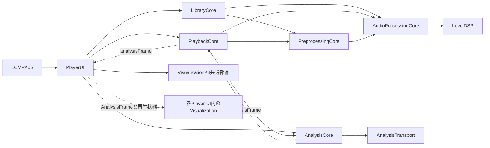

# Player UI・可視化の開発ガイド

[設計書一覧](./README.md)に戻る。

Player UIは再生操作と画面構成を扱い、可視化は解析結果から表示を作る。現在の実装名・組込IDは`LCMP_default_GEQ`で、16列の蛍光管LEDとコンパクトな操作画面を組み合わせる。この文書は、ソース配置、他モジュールとのI/F、可視化の開発・追加手順をまとめる。

製品仕様は[基本設計](./basic-design.md)と[UI・UX設計](./ui-ux-design.md)、具体的な画面動作は[コンパクト画面](./compact-ui-implementation.md)、提示待ち・残光・描画の詳細は[可視化の実装設計](./visualization-implementation.md)を参照する。

## ソースコードの配置

```text
Sources/
├── LCMPApp/
│   └── LCMPApp.swift                  アプリ・ウィンドウ・ファイル選択
├── PlayerUI/
│   ├── PlayerView.swift               アプリ向けのメイン画面入口
│   └── Players/
│       └── LCMP_default_GEQ/          このPlayer UIの実装一式
│           ├── LCMPDefaultGEQ.swift   ID・名前・解析設定・表示データへの変換
│           ├── LCMPDefaultGEQPlayerView.swift  メイン画面と操作部
│           ├── PlayerPresentation.swift       画面状態とdriverの所有
│           ├── ExtensionView.swift            拡張画面
│           ├── WindowLayout.swift             ウィンドウ配置の計算
│           ├── NativeControls.swift           移動・シーク・音量の入力
│           ├── LibraryControls.swift          リスト操作・グラス等
│           ├── SourceFolderList.swift         音源フォルダ一覧
│           ├── QuickTooltip.swift            省略されたタイトルの表示
│           └── Visualization/
│               ├── PlaybackVisualization.swift    再生・解析と描画の接続
│               ├── LCMPDefaultGEQView.swift        SwiftUI/Canvasとrenderer
│               ├── LCMPDefaultGEQScale.swift       dBFSから表示感度への変換
│               ├── SpectrumPresentation.swift     提示待ち・16×24セル・残光
│               └── VisualizationDriver.swift      MainActorの受信・共通時計
├── VisualizationKit/
│   └── Shared/
│       ├── SpectrumSample.swift       UIに依存しない表示用レベル・時刻の値型
│       └── VisualizationClock.swift   共通host clock・activity
├── PreprocessingCore/                 先頭PCM準備・LUFS/ピーク測定・共通デコーダ/形式変換
├── AudioProcessingCore/               測定値・設定・補正計画・独立gain段
├── LevelDSP/                          worker用K-weighting/true peak補間（C）
├── PlaybackCore/                      再生制御・音声バックエンド
├── LibraryCore/                       ライブラリ・リスト・ファイル参照
├── AnalysisCore/                      FFT・帯域パワー・解析時刻
└── AnalysisTransport/                 音声側の固定容量PCM受渡し

Tests/PlayerUITests/Players/LCMP_default_GEQ/
├── NativeViewTests.swift
├── WindowLayoutTests.swift
├── FolderTooltipTests.swift
├── VisualizationIntegrationTests.swift
└── Visualization/
    ├── PresentationTests.swift
    └── VisualizationPerformanceTests.swift
```

**1つのPlayer UIの実装は、可視化も含めて`PlayerUI/Players/<実装ID>/`の1つのフォルダ配下へまとめる。** 内部の整理には`Visualization/`等のサブフォルダを使う。解析設定、表示感度、driver、残光、描画、画面状態、入力、配置もこの実装の一部である。

`VisualizationKit/Shared/`はUIに依存しない共通部品だけを置く。個別Player UIの描画を登録したり、個別のView・スケール・driverを参照したりしない。Player UIから共通部品を利用する一方向の依存にする。音声エンジン・FFT・ライブラリ保存はそれぞれのCoreモジュールへ委ねる。

フォルダはSwiftモジュールや名前空間ではない。Player UIごとのソースは現在の`PlayerUI`ターゲット内でコンパイルされる。新しい型には実装固有の接頭辞を付け、別実装に同名の`PlayerPresentation`等を重複定義しない。通常のSwiftファイルはサブフォルダもSwiftPMが検出するため、移動や追加だけなら`Package.swift`の変更は不要である。ターゲットや画像等のresourcesを追加する場合は別途manifestを変更する。

## モジュール間のI/F



実線は利用・依存、破線はデータの流れを示す。`PlayerUI`が`AnalysisCore`の解析結果を受け取り、専用フォルダ内の可視化へ渡す。`VisualizationKit`は共通の値型と時計だけを提供し、他のアプリ固有モジュールへ依存しない。

| 境界 | 公開I/F | 呼出側の責務 |
| --- | --- | --- |
| アプリ → メイン画面 | `PlayerView(playback:presentation:library:chooseFile:toggleExtension:)` | 再生・ライブラリ・画面状態を所有して渡す。ファイル選択とウィンドウ操作はclosureで渡す |
| アプリ → 拡張画面 | `ExtensionView`、`LibraryActions`、`resizeExtension` closure | ファイル選択・修復・M3U8入出力とAppKitウィンドウ変更を担当する |
| 画面 → 再生 | `PlaybackController` | `togglePlayPause()`、`stop()`、`seek(to:)`、`setVolume(_:)`、`toggleMute()`等の公開操作を使う |
| 画面 → ライブラリ | `LibraryController` | 再生開始・停止・前後曲・編集・取り込みを公開操作へ渡す。`isPreparing`と`peakMeasurement`を表示し、測定設定は`setMeasuresMaximumVolume(_:)`で変更する |
| 画面 → 解析購読 | `PlaybackController.configureAnalysis(_:)` | 表示するデザインの`AnalysisConfiguration`を設定し、非表示時はnilで解除する |
| 再生 → 画面 | `analysisFrame`、`analysisResetID`、`state` | 最新フレームを渡し、状態・取消ID変更を可視化へ反映する |
| 画面 → 可視化状態 | `VisualizationDriver.synchronize(activity:visible:)`、`receive(_:)`、`reset()` | MainActorで再生状態・表示可否・解析結果・シーク等のリセットを渡す |
| 状態 → 描画 | `LCMPDefaultGEQView(driver:)` | `snapshot`と`drawTime`を描く。描画内から再生や解析を開始しない |

背景選択は非同期で確定する。前処理のバッファや全曲測定をUIへ持ち込まず、sample peak専用には検証済みの`currentTrackPeak`、LUFS/true peakには`currentTrackMetrics`を使う。完了値の永続化とAuditは[測定キャッシュ](./measurement-cache-implementation.md)が担当し、Viewは保存を所有しない。詳細は[再生前処理の実装設計](./preprocessing-implementation.md)を参照する。

LUFS/true peakによる自動調整は[音量自動調整の設計](./audio-processing-design.md)を参照する。上記の現行`currentTrackPeak`はsample peak専用であり、自動調整用の完了結果として流用しない。設定は`setNormalizesVolume`／`setNormalizationTarget`、測定結果は`levelMeasurement`／`currentTrackMetrics`を使い、`preparationStage`で全曲測定待ちを表示する。EQ/delayの処理段は将来の拡張として区別する。

公開入口の実装は[PlayerView.swift](../Sources/PlayerUI/PlayerView.swift)、実際の橋渡しは[PlaybackVisualization.swift](../Sources/PlayerUI/Players/LCMP_default_GEQ/Visualization/PlaybackVisualization.swift)にある。後者は約30Hzの解析結果の観測を局所化し、操作部全体の再評価を抑える。

`PlaybackController`と`LibraryController`の操作・UI状態・driverはMainActorで扱う。音声コールバックとFFTワーカーからViewやdriverを直接呼ばない。PCMの取得・バッファ・FFTの寿命は既存の`PlaybackCore`と`AnalysisCore`へ委ねる。

## 解析データの契約

`AnalysisConfiguration`は帯域数8〜128、更新頻度15/30/60Hz、FFTサイズ1024/2048/4096/8192点を受け付ける。現在のデザインは次で設定を取得する。

```swift
let configuration = LCMPDefaultGEQ.configuration  // 16帯域・30Hz・2048点
playback.configureAnalysis(configuration)
```

`configureAnalysis`はアプリの再生経路に対する単一の購読設定であり、各Viewが独立した音声tapを追加するAPIではない。表示中のデザインを決める側が設定を合わせる。Viewの再評価ごとに同じ設定を作り直して購読し直さず、現在値と比較して必要時だけ変更する。

| `AnalysisFrame`のフィールド | 意味・利用上の条件 |
| --- | --- |
| `generation` / `sequence` | 解析世代と世代内の連番。世代変更で旧状態を捨て、古い連番を再表示しない |
| `bandEdgesHz` | 下限20Hzからmin(20kHz, Nyquist)までの対数帯域境界。要素数は帯域数＋1 |
| `bandDBFS` | 左右の帯域パワーを平均した−100〜0dBFS。平均二乗値1を0dBFSとする。左右波形を加算してから解析しない |
| `levels` | 解析API共通の−100〜0dBFSを0〜1へ写した値。デザイン専用の表示感度とは区別する |
| `leftRMS` / `rightRMS`、`leftPeak` / `rightPeak` | 左右の波形レベル。可視化が必要とする場合だけ利用する |
| `timing` | 元のPCM区間、生成時刻、推定出力遅延・提示時刻。詳細は下記 |
| `droppedBuffers` / `queuedBufferHighWatermark` / `computationSeconds` | PCM取得側の累積欠落、使用スロット最大値、FFT処理時間。性能検証用 |

音声はアプリ内の音量・ミュートより前で観測する。ミュートやアプリ音量0でも表示は動く。可視化は音源を再度開いたり、再デコードしたり、出力音へ加工を加えたりしない。

`LCMP_default_GEQ`は`bandDBFS`から`level = clamp((dBFS + 80) / 80, 0, 1)`を求め、24段へ切り捨てて量子化する。−80dBFS以下は0段、−60dBFSは6段、−40dBFSは12段、−20dBFSは18段、0dBFSは24段になる。二重に対数を取らず、自動ゲイン調整を行わない。色はセルの物理位置に固定し、セル本体は常に二値のON/OFFとする。

狭すぎてFFT binが入らない帯域は解析下限値となる。帯域数を増やしてもFFTの周波数分解能は増えない。見た目を埋めるために欠けた帯域の測定値を捏造しない。

## 時刻と表示状態の契約

すべてのhost時刻は単調増加する`AVAudioTime`のhost clockを秒へ換算した値である。描画・driverも`VisualizationClock.now()`で同じ時計を使う。`Date`やコールバック到着時刻を音声の提示時刻として代用しない。

| 時刻 | 用途 |
| --- | --- |
| `windowCenterHostTime` | 解析窓の中央の音声時刻。取得できないときはnil |
| `producedHostTime` | 解析結果が準備された時刻 |
| `estimatedPresentationHostTime` | 窓中央＋下流の推定出力遅延＋適用済み音声補償量。入力不足ならnil |
| `SpectrumSample.presentationAt` | 実装固有の`init(defaultGEQFrame:)`で上記の推定提示時刻をそのまま引き継ぐ。正しい未来時刻なら表示側で待つ |
| `drawTime` | driverが状態を公開したhost時刻。残光の経過時間に使う。画面への物理的な提示を測った時刻ではない |

現在の適用済み音声遅延は0である。提示待ちのために再生位置・音声速度・出力設定を変えない。物理出音とディスプレイの同期精度は別途測定が必要である。

`SpectrumPresentation`は最大64フレームの提示待ちを持ち、期限が来た中の最新1件だけを採用する。配列数が16でない入力、NaN/Infinity、古い連番・古すぎる結果を拒否する。無効な提示時刻は即時表示へフォールバックする。更新が250ms以上なく待ちも空なら消灯と残光へ移り、データ待ちを表示する。正しい無音データの全消灯とデータ欠落を区別する。

`SpectrumPresentation`・`SpectrumSnapshot`・`VisualizationDriver`は現在の16列×24段に対応する実装で、名前に共通語が含まれていても全可視化共通の状態形式ではない。このため`Players/LCMP_default_GEQ/Visualization/`に置く。別の列数や人形等の可視化へ転用する場合は、その実装の状態形式・driverを用意し、描画の入口も合わせる。

## 寿命管理と画面への組み込み

`PlayerPresentation`がdriverを1つ所有し、SwiftUIのbody評価ごとに生成しない。`PlaybackVisualization`が状態を中継し、`LCMPApp`はウィンドウの開閉・最小化から表示可否と解析購読を更新する。

| 変更 | 接続側の処理 |
| --- | --- |
| 表示・再生開始 | デザインの解析設定を適用し、`synchronize(activity: .playing, visible: true)`。新着フレームを`receive(_:)`へ渡す |
| 新着解析 | generationとsequenceの変更を観測して最新1件を渡す。表示待ちをUI側で追加して二重に遅延させない |
| 一時停止 | `.paused`を渡して点灯セルを保持し、未来の待ちを破棄。残光が消えたら時計を止める |
| 再開 | `.playing`への遷移で旧状態を破棄し、新世代の解析から開始する |
| 停止・自然終了・再生失敗 | `.inactive`で消灯し、待ち・描画時計を解放する |
| シーク・解析再設定等 | `analysisResetID`の変更で`reset()`し、旧表示を破棄する。`analysisFrame`が既にnilでも省略しない |
| 閉じる・最小化 | `visualizationVisible = false`で直ちにdriverを止め、解析設定をnilにする。音声再生は続ける |
| 復帰 | 表示可否と解析設定を戻し、現在の再生状態から再開する |
| 終了 | 非表示処理に加え、既存の再生・ライブラリ終了処理を実行する |

非表示になった`NSHostingView`の`onChange`や`onDisappear`だけに終了を任せない。`PlayerPresentation.visualizationVisible`は非表示指定時にdriverを直接停止する。描画には1つの取消可能な時計を使い、セルごとのTaskやTimerを作らない。非表示・解放後にTaskがdriverを保持し続けないようにする。

可視化Viewは`.allowsHitTesting(false)`とし、Player UI側のドラッグ移動・シーク等の入力面を妨げない。独自の入力操作を持つ新しい可視化は、どの領域で入力を受けるかをPlayer UI側と合わせる。支援技術には表示名と待機状態を公開し、毎フレームのレベルを読み上げない。動きを減らす設定では残光を省略する。

## 新しい実装を追加する手順

### Player UI全体を追加する場合

1. 固有IDを決め、`PlayerUI/Players/<ID>/`を作る。メインView、拡張画面、画面状態、入力、ウィンドウ配置、解析設定をまとめ、可視化も同じフォルダ内の`Visualization/`へ置く。別のモジュールに同名の実装フォルダを追加する必要はない。
2. `LCMPDefaultGEQ.swift`に相当する、そのUI専用の記述型を用意する。安定したID、表示名、`AnalysisConfiguration`、`AnalysisFrame`から表示用データへの変換を定義する。型名には固有の接頭辞を付ける。
3. 表示スケール・状態・driver・描画を実装する。`SpectrumSample`や`VisualizationClock`等の共有部品は`VisualizationKit`から利用できる。16×24以外の表示は専用の状態形式を用意し、既存のセル数を前提とする型へ押し込まない。共通データには個別UIの変換を組み込まず、実装フォルダ内のアダプターで変換する。
4. `PlayerUI/PlayerView.swift`から新しい実装を呼び出す。現在は`LCMPDefaultGEQPlayerView`への固定委譲である。フォルダの追加だけで自動登録や切り替えは行われない。
5. `LCMPApp`でメインと拡張のView、画面状態、ウィンドウ寸法・配置、解析設定を同じ実装へ揃える。現在の`PlayerPresentation`・`ExtensionView`・`WindowLayout`は`LCMP_default_GEQ`固有であり、新UIの状態を使う場合は入口の引数とアプリ側の所有も合わせる。
6. 再生・ライブラリ操作は既存controllerの公開I/Fへ渡す。ウィンドウの表示と解析購読、再生状態、`analysisResetID`、世代変更を接続する。非表示・切替時は旧driverと解析購読を解除する。
7. `Tests/PlayerUITests/Players/<ID>/`へ画面と可視化の検証を置く。必要なら内部を`Visualization/`へ整理する。既存UIの検証も残す。

例えば新しいUIを`LCMP_analog_meter`とする場合は、次の配置にする。

```text
PlayerUI/Players/
├── LCMP_default_GEQ/
└── LCMP_analog_meter/
    ├── AnalogMeter.swift              ID・名前・解析設定・データ変換
    ├── AnalogMeterPlayerView.swift    画面と操作
    ├── AnalogMeterPresentation.swift  画面状態
    └── Visualization/
        ├── PlaybackVisualization.swift
        ├── AnalogMeterView.swift
        ├── AnalogMeterScale.swift
        └── AnalogMeterDriver.swift
```

必要なファイルだけ追加し、拡張画面や独自のウィンドウ配置が必要なら同じ実装フォルダへ加える。別実装を同じSwiftモジュールへ置くため、例の`PlaybackVisualization.swift`内の型名にも`AnalogMeter`等の接頭辞を付け、既存の型名と衝突させない。

### 現在のUIの可視化だけを変える場合

`Players/LCMP_default_GEQ/Visualization/`内で描画・スケール・状態を変更し、必要なら同じ実装フォルダ内の`LCMPDefaultGEQ.configuration`とフレーム変換を合わせる。既存UIを残して独立したPlayer UIとして扱う場合は、新しいIDのフォルダを作る。複数UIで共有すると決めた部品は、個別実装への依存を取り除いた上で`Shared/`等へ抽出する。

フォルダ分離はソースの責務を示すもので、アクセス制御の隔離ではない。独立した依存関係や配布が必要になったときは、その具体的な要件に合わせてSwiftPMターゲットの分割を検討する。

## 検証方法

基本の回帰は次で実行する。

```sh
LCMP_TEST_AUDIO_OUTPUT=0 ./scripts/swift.sh test --disable-automatic-resolution --no-parallel
```

可視化の状態・寿命・単体描画だけを確認する場合は、次で画像も保存できる。

```sh
LCMP_UI_SNAPSHOTS=build/player-ui-qa \
./scripts/swift.sh test --disable-automatic-resolution --no-parallel \
  --filter 'PresentationTests|VisualizationLifecycleTests'
```

実出力とメイン画面への接続も含めた全体の検証は次で行う。

```sh
LCMP_TEST_AUDIO_OUTPUT=1 LCMP_UI_SNAPSHOTS=build/player-ui-qa \
./scripts/swift.sh test --disable-automatic-resolution --no-parallel
```

全体の実出力検証では`--no-parallel`を明示する。suiteの`.serialized`だけでは別suiteのMainActor処理による短い音源の観測漏れを防げない。可視化専用の生成音源はアプリ音量0で再生し、OS音量は変更しない。

表示スケールでは既知のdB値・無音・非数値・上限と、実PCMの振幅を変えたときの段数を検証する。寿命ではpause/resume/seek/stop/自然終了/hide/showを確認する。ネイティブ画像では色・二値セル・残光・上下余白・操作部との非重複を確認する。実行結果は設計書ではなくローカル専用の`DEVELOPMENT_NOTES.md`へ記録する。

負荷・同期を変更した場合の短時間比較と10分連続測定は[可視化の実装設計](./visualization-implementation.md#検証と測定方法)に従う。物理的な出音と画面提示の同期を主張する場合は、オフスクリーン描画の時間とは別に測定する。

利用中のアプリとは別に確認用bundleを作るには、次を使う。

```sh
python3 scripts/build-app.py --output build/player-ui-check/LCMP.app
```

この出力先のアプリが起動中なら、別の新しい出力先を使う。
